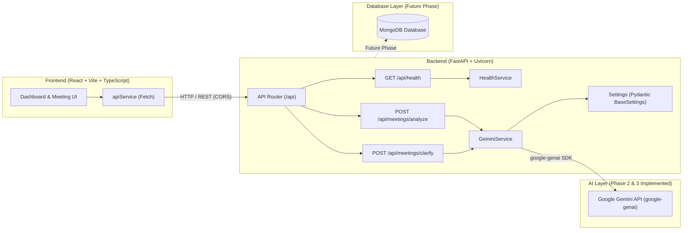

# MeetMind AI — AI-Powered Meeting-to-Action Assistant

[](https://fastapi.tiangolo.com/)
[](https://react.dev/)
[](https://www.typescriptlang.org/)
[](https://tailwindcss.com/)
[](https://ai.google.dev/)
[](README.md)

**MeetMind AI** is an intelligent assistant engineered to bridge the gap between spoken or transcribed meeting conversations and structured execution. It converts raw, unstructured meeting transcripts into actionable summaries, decisions, explicit task ownership, strict deadlines, and clarifying questions.

Designed for college lab evaluation, MeetMind AI emphasizes clean architectural separation, production-ready standards, type safety, and maintainable software engineering principles.

---

## 1. Problem Statement

Modern teams spend substantial time in meetings, yet critical execution items often get lost in lengthy transcriptions or informal notes:
- **Information Overload**: Parsing multi-page transcripts to identify what was decided is inefficient.
- **Ambiguous Ownership**: Action items are frequently mentioned without clear owners (e.g., *"Someone should send the report"*).
- **Vague Deadlines**: Due dates are framed loosely without calendar context (e.g., *"Let's finish this by Friday"*).
- **Conflating Suggestions with Decisions**: Preliminary brainstorming (e.g., *"We should consider launching next month"*) is often incorrectly cataloged as a confirmed decision.
- **Incomplete Deliverables**: Key prerequisites and clarification questions often emerge only after work begins, causing avoidable delays.

MeetMind AI automates the extraction and structuring of these elements, actively flags meaningful ambiguities, and facilitates a structured clarification feedback loop.

---

## 2. Project Objectives

- **Automated Structuring**: Extract summaries, key discussion points, and critical decisions from conversational meeting text.
- **Ambiguity Detection**: Proactively identify and categorize missing owners, vague deadlines, ambiguous task scopes, and proposals vs. decisions.
- **Clarification Workflow**: Re-evaluate and refine meeting insights through targeted user feedback without hallucinating details.
- **Action Item Extraction**: Identify actionable tasks, assigned owners, and explicit or implicit deadlines with stable IDs.
- **Clean Architecture**: Decouple the client dashboard, API services, AI orchestration, and persistent storage.

---

## 3. Technology Stack

### Frontend (Implemented in Phase 1)
- **Framework**: React 18 with Vite
- **Language**: TypeScript
- **Styling**: Tailwind CSS (Dark navy/slate theme with indigo accents)
- **Icons**: Lucide React
- **HTTP Client**: Centralized Fetch API client (`apiService`)

### Backend (Implemented in Phase 1, 2 & 3)
- **Framework**: Python 3.11+ with FastAPI
- **Server**: Uvicorn (ASGI)
- **AI Integration**: Google Gemini API via official `google-genai` Python SDK
- **Model**: `gemini-2.5-flash` (configurable)
- **Validation & Settings**: Pydantic v2 & `pydantic-settings`
- **Testing**: Pytest & HTTPX TestClient with mocked Gemini calls (19 automated tests)
- **Middleware**: Fast CORS middleware configured for Vite development servers

### Data Layer (Reserved for Future Phase)
- **Database (Phase 4)**: MongoDB for persistent meeting records and action items

---

## 4. Phase Status: Implemented vs. Planned

| Feature / Component | Status | Details |
| :--- | :---: | :--- |
| **Workspace & Repository Scaffold** | Completed | Clean monorepo structure separating `frontend/`, `backend/`, and `docs/`. |
| **Backend REST Health Check** | Completed | `GET /api/health` returns status and application metadata with CORS support. |
| **Backend Settings & Validation** | Completed | Pydantic v2 configuration management with environment variable loading. |
| **Frontend Dashboard UI** | Completed | Modern dark navy/slate dashboard with sidebar, stats cards, and meeting input. |
| **Client-Server Handshake** | Completed | Centralized `apiService` pings `/api/health` and displays real-time connection status. |
| **Transcript Input Form** | Completed | Title, transcript textarea with word/character counter, and sample transcript loader. |
| **Gemini AI Backend Integration** | Completed | `POST /api/meetings/analyze` converts transcripts into structured JSON via `google-genai`. |
| **Anti-Hallucination Guardrails** | Completed | Extraction rules prevent inventing owners/deadlines; uses `null` for unassigned fields. |
| **Ambiguity Detection Engine** | Completed | Detects and tags ambiguities across ownership, deadlines, task scope, and proposals. |
| **Interactive Clarification Workflow** | Completed | `POST /api/meetings/clarify` updates analysis based on submitted clarification answers. |
| **MongoDB Database Storage** | *Planned (Phase 4)* | Persistent storage for meeting archives, action item statuses, and user settings. |
| **Frontend Clarification UI** | *Planned (Phase 4)* | Interactive clarification Q&A cards directly in the React dashboard. |

---

## 5. System Architecture & Ambiguity Workflow



---

## 6. Project Structure

```text
meetmind-ai/
│
├── frontend/
│   ├── public/                 # Static assets
│   ├── src/
│   │   ├── components/         # Reusable UI components
│   │   │   ├── EmptyState.tsx
│   │   │   ├── Header.tsx
│   │   │   ├── NewMeetingSection.tsx
│   │   │   ├── Sidebar.tsx
│   │   │   └── StatsCard.tsx
│   │   ├── pages/              # View pages (Dashboard)
│   │   │   └── Dashboard.tsx
│   │   ├── services/           # Centralized API service
│   │   │   └── api.ts
│   │   ├── types/              # TypeScript interfaces & types
│   │   │   └── index.ts
│   │   ├── App.tsx             # Root component with health polling
│   │   ├── index.css           # Tailwind directives & theme styling
│   │   ├── main.tsx            # React DOM entrypoint
│   │   └── vite-env.d.ts       # Vite environment type declarations
│   ├── .env.example            # Client environment variable template
│   ├── index.html              # HTML entrypoint
│   ├── package.json            # Frontend dependencies & build scripts
│   ├── postcss.config.js       # PostCSS configuration for Tailwind
│   ├── tailwind.config.js      # Tailwind configuration with brand theme
│   ├── tsconfig.json           # TypeScript project references
│   ├── tsconfig.app.json       # App TypeScript configuration
│   ├── tsconfig.node.json      # Node TypeScript configuration
│   └── vite.config.ts          # Vite configuration
│
├── backend/
│   ├── app/
│   │   ├── api/
│   │   │   ├── routes/
│   │   │   │   ├── __init__.py
│   │   │   │   ├── health.py   # GET /api/health route
│   │   │   │   └── meetings.py # POST /analyze & POST /clarify routes
│   │   │   ├── __init__.py
│   │   │   └── router.py       # API router registration
│   │   ├── core/
│   │   │   ├── __init__.py
│   │   │   └── config.py       # Pydantic BaseSettings & Gemini config
│   │   ├── schemas/
│   │   │   ├── __init__.py
│   │   │   ├── health.py       # Health response schemas
│   │   │   └── meeting.py      # Meeting & Clarification request/response schemas
│   │   ├── services/
│   │   │   ├── __init__.py
│   │   │   ├── gemini_service.py # Gemini extraction, ambiguity detection & re-evaluation
│   │   │   └── health_service.py # Health check business logic
│   │   ├── __init__.py
│   │   └── main.py             # FastAPI entrypoint, middleware, errors
│   ├── tests/
│   │   ├── __init__.py
│   │   ├── test_health.py      # Health & CORS test suite
│   │   └── test_meetings.py    # Meeting analysis & Clarification test suite (16 tests)
│   ├── .env.example            # Backend environment variable template
│   └── requirements.txt        # Python dependencies (includes google-genai)
│
├── docs/
│   └── architecture.md         # System design & clarification workflow documentation
│
├── .gitignore                  # Comprehensive Git exclusion rules
└── README.md                   # Project documentation
```

---

## 7. Environment Variables Configuration

Both the frontend and backend utilize `.env.example` templates. **Never commit actual `.env` files with secret keys.**

### Backend (`backend/.env.example`)

```env
GEMINI_API_KEY=your_gemini_api_key_here
GEMINI_MODEL=gemini-2.5-flash
MONGODB_URI=mongodb://localhost:27017
DATABASE_NAME=meetmind_ai
```

### Frontend (`frontend/.env.example`)

```env
VITE_API_BASE_URL=http://localhost:8000
```

---

## 8. API Specification

### 8.1 Analyze Meeting Transcript
`POST /api/meetings/analyze`

**Request Body**:
```json
{
  "title": "Mobile App Redesign Sync",
  "transcript": "Sarah: Let us review the blockers for the milestone release.\nDavid: The Figma tokens are ready. I need Alex to confirm the GraphQL schema by Wednesday 4 PM.\nAlex: I will finalize the endpoint by Wednesday 4 PM once security signs off.\nPriya: We need test credentials for the staging sandbox. Someone should provision them by tomorrow morning."
}
```

**Response Body**:
```json
{
  "summary": "The team aligned on the mobile app redesign milestones and identified staging access requirements.",
  "discussion_points": [
    "Figma design system token handoff from David",
    "GraphQL schema updates for user preferences",
    "Staging sandbox test credentials requirement"
  ],
  "decisions": [
    "Alex will finalize GraphQL endpoints by Wednesday at 4 PM"
  ],
  "action_items": [
    {
      "id": "action_1",
      "task": "Confirm and finalize GraphQL schema changes for user preferences",
      "owner": "Alex",
      "deadline": "Wednesday 4 PM",
      "status": "pending"
    },
    {
      "id": "action_2",
      "task": "Provision test credentials for the staging sandbox",
      "owner": null,
      "deadline": "Tomorrow morning",
      "status": "pending"
    }
  ],
  "clarification_required": true,
  "clarification_question": "Who is specifically responsible for provisioning the staging sandbox test credentials by tomorrow morning?",
  "clarifications": [
    {
      "id": "clarif_1",
      "category": "ownership",
      "original_statement": "Someone should provision them by tomorrow morning.",
      "explanation": "No specific individual or team was assigned to provision staging access.",
      "question": "Who is specifically responsible for provisioning the staging sandbox test credentials by tomorrow morning?",
      "related_action_item_id": "action_2",
      "resolved": false
    }
  ]
}
```

---

### 8.2 Submit Clarification Answers
`POST /api/meetings/clarify`

Submits answers to open clarification questions. The backend re-evaluates the analysis and updates only the relevant action items or decisions.

**Request Body**:
```json
{
  "analysis": {
    "summary": "The team aligned on the mobile app redesign milestones and identified staging access requirements.",
    "discussion_points": ["Figma tokens", "GraphQL schema", "Staging credentials"],
    "decisions": ["Alex will finalize GraphQL endpoints by Wednesday at 4 PM"],
    "action_items": [
      {
        "id": "action_1",
        "task": "Confirm and finalize GraphQL schema changes",
        "owner": "Alex",
        "deadline": "Wednesday 4 PM",
        "status": "pending"
      },
      {
        "id": "action_2",
        "task": "Provision test credentials for the staging sandbox",
        "owner": null,
        "deadline": "Tomorrow morning",
        "status": "pending"
      }
    ],
    "clarification_required": true,
    "clarification_question": "Who is specifically responsible for provisioning the staging sandbox test credentials by tomorrow morning?",
    "clarifications": [
      {
        "id": "clarif_1",
        "category": "ownership",
        "original_statement": "Someone should provision them by tomorrow morning.",
        "explanation": "No specific individual or team was assigned to provision staging access.",
        "question": "Who is specifically responsible for provisioning the staging sandbox test credentials by tomorrow morning?",
        "related_action_item_id": "action_2",
        "resolved": false
      }
    ]
  },
  "answers": [
    {
      "clarification_id": "clarif_1",
      "answer": "David from DevOps will provision the staging test credentials by tomorrow 10 AM."
    }
  ]
}
```

**Updated Response Body**:
```json
{
  "summary": "The team aligned on mobile app redesign milestones and assigned staging credentials provisioning to David from DevOps.",
  "discussion_points": ["Figma tokens", "GraphQL schema", "Staging credentials"],
  "decisions": ["Alex will finalize GraphQL endpoints by Wednesday at 4 PM"],
  "action_items": [
    {
      "id": "action_1",
      "task": "Confirm and finalize GraphQL schema changes",
      "owner": "Alex",
      "deadline": "Wednesday 4 PM",
      "status": "pending"
    },
    {
      "id": "action_2",
      "task": "Provision test credentials for the staging sandbox",
      "owner": "David",
      "deadline": "Tomorrow 10 AM",
      "status": "pending"
    }
  ],
  "clarification_required": false,
  "clarification_question": null,
  "clarifications": [
    {
      "id": "clarif_1",
      "category": "ownership",
      "original_statement": "Someone should provision them by tomorrow morning.",
      "explanation": "No specific individual or team was assigned to provision staging access.",
      "question": "Who is specifically responsible for provisioning the staging sandbox test credentials by tomorrow morning?",
      "related_action_item_id": "action_2",
      "resolved": true
    }
  ]
}
```

---

## 9. Installation & Setup Guide

### Prerequisites
- **Node.js**: v18+ (tested on Node v26)
- **npm**: v9+ (tested on npm 11)
- **Python**: 3.11+
- **Google Gemini API Key**: Obtainable from [Google AI Studio](https://aistudio.google.com/)

---

### Backend Setup

1. **Navigate to the backend directory**:
   ```bash
   cd backend
   ```

2. **Create and activate a virtual environment**:
   ```bash
   python3 -m venv .venv
   source .venv/bin/activate    # On macOS/Linux
   # or: .venv\Scripts\activate # On Windows
   ```

3. **Install dependencies**:
   ```bash
   pip install -r requirements.txt
   ```

4. **Run the complete automated test suite (19 tests)**:
   ```bash
   pytest -v tests/
   ```

5. **Start the FastAPI server**:
   ```bash
   uvicorn app.main:app --reload --host 0.0.0.0 --port 8000
   ```

The backend server is accessible at `http://localhost:8000`.
- Health Endpoint: `http://localhost:8000/api/health`
- Meeting Analysis Endpoint: `http://localhost:8000/api/meetings/analyze`
- Clarification Resolution Endpoint: `http://localhost:8000/api/meetings/clarify`
- Interactive Swagger Docs: `http://localhost:8000/docs`

---

### Frontend Setup

1. **Navigate to the frontend directory**:
   ```bash
   cd frontend
   ```

2. **Install dependencies**:
   ```bash
   npm install
   ```

3. **Build the production bundle**:
   ```bash
   npm run build
   ```

4. **Start the Vite development server**:
   ```bash
   npm run dev
   ```

The frontend dashboard will be available at `http://localhost:5173`.

---

## 10. Development Roadmap

- [x] **Phase 1: Project Foundation & Handshake**
  - Project architecture & directory structure
  - FastAPI server with health check & CORS
  - React + TypeScript + Tailwind CSS dashboard UI
  - Real-time client-to-server health handshake
  - Clean Git repository setup and comprehensive documentation
- [x] **Phase 2: Google Gemini AI Integration**
  - Integrate official `google-genai` Python SDK
  - Pydantic schema contracts for `MeetingAnalysisRequest` and `MeetingAnalysisResponse`
  - Anti-hallucination prompt engineering (enforce `null` for unstated owners/deadlines)
  - Robust JSON parsing with markdown-fence sanitization
  - Comprehensive unit test suite with mocked Gemini calls
- [x] **Phase 3: Ambiguity Detection & Clarification Workflow**
  - Detect ambiguous ownership, deadlines, task scope, and decision vs. suggestion
  - Structured `clarifications` data model with stable IDs and category tags
  - Interactive clarification re-evaluation endpoint (`POST /api/meetings/clarify`)
  - Safe, non-destructive updating of action items and decisions
  - Comprehensive test suite covering 19 test scenarios
- [ ] **Phase 4: Database & UI Clarification Integration**
  - MongoDB connection and schema definitions
  - Meeting transcript archiving and retrieval
  - Action item status tracking (pending, completed, blocked)
  - Interactive clarification Q&A cards directly in the React frontend
