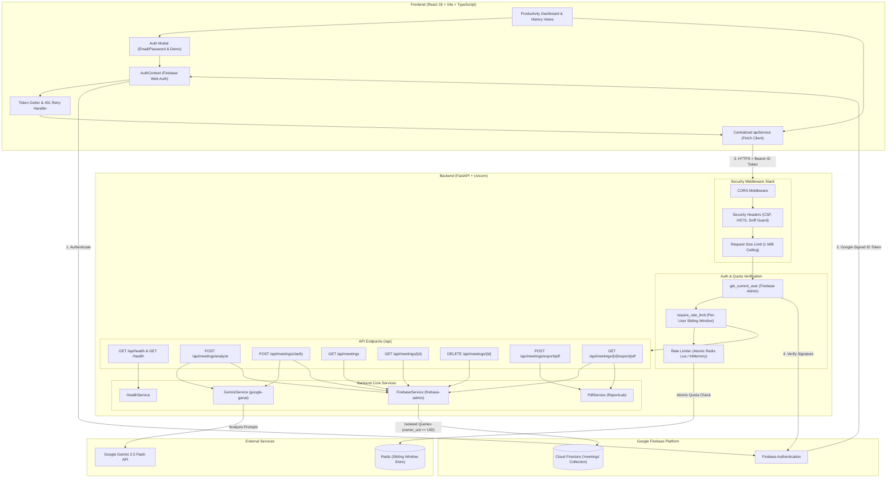

# MeetMind AI — AI-Powered Meeting-to-Action Assistant

[](https://fastapi.tiangolo.com/)
[](https://react.dev/)
[](https://www.typescriptlang.org/)
[](https://tailwindcss.com/)
[](https://ai.google.dev/)
[](https://firebase.google.com/)
[](https://firebase.google.com/docs/auth)
[](https://www.reportlab.com/)
[](https://redis.io/)
[](README.md)

**MeetMind AI** is an enterprise-ready intelligent assistant engineered to bridge the gap between spoken or transcribed meeting conversations and structured execution. It converts raw, unstructured meeting transcripts into actionable summaries, verified decisions, explicit task ownership, strict deadlines, and clarifying questions—with multi-user isolation in Firebase Cloud Firestore, cryptographic Bearer token authentication, distributed rate limiting, and publication-grade PDF report exports.

Designed with production standards, MeetMind AI emphasizes clean architectural separation, strict anti-hallucination guardrails, type safety, and defensive security engineering.

---

## 1. Key Capabilities

- **Automated Structuring**: Extracts executive summaries, key discussion points, and critical decisions from conversational meeting text.
- **Anti-Hallucination Guardrails**: Enforces `null` for unmentioned task owners and deadlines; never guesses or infers assignees.
- **Ambiguity Detection Engine**: Categorizes ambiguities across ownership, deadlines, task scope, and decision vs. suggestion.
- **4-Way Classification Strategy**:
  1. *Needs Clarification*: Active ambiguities generating targeted questions.
  2. *Open Follow-ups / Deferred*: Postponed deliverables captured without badgering the user with clarification questions.
  3. *Resolved*: Answered ambiguities.
  4. *No Outstanding Issues*: Fully specified deliverables.
- **Interactive Clarification Loop**: In-place re-evaluation with non-destructive merge guardrails preserving unrelated items.
- **Multi-User Authentication**: Firebase Web Authentication on the client supporting Email/Password and instant Anonymous Demo account access.
- **Cryptographic Token Verification**: Backend validates Google-signed JWT Bearer tokens via `firebase-admin` without trusting client-supplied UIDs.
- **Multi-Tenant Ownership Isolation**: All meeting queries and mutations are isolated by `owner_uid`. Access to other users' records returns `404 Not Found`.
- **Abuse & Rate Limit Protection**: Sliding-window rate limiting powered by an atomic Redis Lua script (with in-memory fallback for local development).
- **Defensive Middleware**: Enforces a 1 MiB request body ceiling (`RequestSizeLimitMiddleware`), security headers (CSP, HSTS, frame guard), and CORS validation.
- **Publication-Grade PDF Export**: Server-side ReportLab compilation with two-pass `NumberedCanvas` ("Page X of Y"), in-memory streaming, and safe filename sanitization.
- **Meeting History & Deletion**: Complete lifecycle management with soft confirmation dialogs and permanent Firestore document deletion.

---

## 2. Technology Stack

### Frontend
- **Framework**: React 18 with Vite 5
- **Language**: TypeScript 5
- **Styling**: Tailwind CSS (with light/dark theme toggle and CSS variables)
- **Animations**: Framer Motion (`framer-motion`) — spring modal dialogs, loading states, and transitions
- **Icons**: Lucide React
- **Identity Client**: Firebase Web SDK (`firebase/app`, `firebase/auth`)
- **API Client**: Centralized Fetch client (`apiService`) with automatic Bearer token attachment, transparent single-retry on 401 with token refresh, and binary Blob handlers
- **Testing**: Native Node.js test runner (`node:test`, 32 automated unit tests)

### Backend
- **Framework**: Python 3.11+ with FastAPI 0.115+
- **Server**: Uvicorn (ASGI)
- **AI Integration**: Google Gemini API via official `google-genai` SDK (`gemini-2.5-flash`)
- **Database & Identity**: Firebase Cloud Firestore and Firebase Admin Auth via official `firebase-admin` SDK
- **Rate Limiting**: Atomic Redis Lua sliding-window limiter with thread-safe `InMemoryRateLimiter` fallback
- **PDF Compilation**: ReportLab (`reportlab>=4.2.0`) with custom `NumberedCanvas` and auto-wrapping tables
- **Validation & Settings**: Pydantic v2 & `pydantic-settings`
- **Testing**: Pytest with HTTPX TestClient (99 automated tests, zero-credential CI execution)

---

## 3. System Architecture Diagram



---

## 4. Repository Structure

```text
meetmind-ai/
│
├── frontend/
│   ├── public/                 # Static assets
│   ├── src/
│   │   ├── components/         # Reusable UI components
│   │   │   ├── AnalysisLoadingState.tsx # Multi-stage processing indicator
│   │   │   ├── AnalysisResults.tsx      # Summaries, actions, decisions & export trigger
│   │   │   ├── AuthModal.tsx            # Login, registration & demo access dialog
│   │   │   ├── ClarificationSection.tsx # In-place ambiguity resolution cards
│   │   │   ├── DeleteMeetingModal.tsx   # Soft confirmation dialog for meeting deletion
│   │   │   ├── EmptyState.tsx           # Initial workspace placeholder
│   │   │   ├── Header.tsx               # Top bar, status pill, user avatar & sign-out
│   │   │   ├── RecentMeetingsList.tsx   # History list (compact & grid modes)
│   │   │   ├── Sidebar.tsx              # Sidebar navigation, history & theme switcher
│   │   │   ├── StatsCard.tsx            # Summary metric counters
│   │   │   └── TranscriptWorkspace.tsx  # Input textarea, counters & sample loader
│   │   ├── config/             # Client configuration
│   │   │   └── firebase.ts     # Firebase Web Client SDK initialization
│   │   ├── context/            # Global React Context providers
│   │   │   └── AuthContext.tsx # Firebase auth lifecycle, token getter & demo sign-in
│   │   ├── pages/              # Primary view pages
│   │   │   └── Dashboard.tsx   # Workspace and history view orchestrator
│   │   ├── services/           # Centralized API service
│   │   │   └── api.ts          # REST client with Bearer auth, 401 retry & blob export
│   │   ├── types/              # TypeScript interfaces
│   │   │   └── index.ts        # Pydantic-mirrored data contracts
│   │   ├── App.tsx             # Root component & theme provider
│   │   ├── index.css           # Tailwind directives & theme variables
│   │   ├── main.tsx            # React DOM mounting entrypoint
│   │   └── vite-env.d.ts       # Vite environment type declarations
│   ├── tests/
│   │   └── api.test.mjs        # Frontend unit tests (32 tests via node:test)
│   ├── .env.example            # Frontend environment variable template
│   ├── index.html              # HTML shell entrypoint
│   ├── package.json            # Frontend dependencies & build scripts
│   ├── tailwind.config.js      # Tailwind configuration with brand theme
│   ├── tsconfig.json           # TypeScript configuration
│   └── vite.config.ts          # Vite configuration
│
├── backend/
│   ├── app/
│   │   ├── api/
│   │   │   ├── routes/
│   │   │   │   ├── __init__.py
│   │   │   │   ├── health.py   # GET /api/health probe
│   │   │   │   └── meetings.py # Analyze, clarify, list, get, delete, export routes
│   │   │   ├── __init__.py
│   │   │   └── router.py       # API router registration
│   │   ├── core/
│   │   │   ├── __init__.py
│   │   │   ├── auth.py         # Firebase Admin Bearer token verification dependency
│   │   │   ├── config.py       # Pydantic BaseSettings & production validator
│   │   │   ├── middleware.py   # Request size limit & defensive security headers
│   │   │   └── rate_limit.py   # Atomic Redis Lua sliding-window rate limiter
│   │   ├── schemas/
│   │   │   ├── __init__.py
│   │   │   ├── health.py       # Health response schemas
│   │   │   └── meeting.py      # Meeting, clarification & export schemas
│   │   ├── services/
│   │   │   ├── __init__.py
│   │   │   ├── firebase_service.py # Firestore DAO with multi-user isolation
│   │   │   ├── gemini_service.py   # Gemini prompt engine & merge guardrails
│   │   │   ├── health_service.py   # Health check business logic
│   │   │   └── pdf_service.py      # ReportLab PDF compiler & NumberedCanvas
│   │   ├── __init__.py
│   │   └── main.py             # FastAPI entrypoint, lifespan context, middleware stack
│   ├── scripts/
│   │   └── migrate_legacy_meetings.py # Legacy unowned meeting migration tool
│   ├── tests/
│   │   ├── __init__.py
│   │   ├── conftest.py         # Pytest fixtures and mock client setup
│   │   ├── test_auth.py        # Token verification & ownership isolation (10 tests)
│   │   ├── test_firebase.py    # Firestore CRUD, updates & deletion (13 tests)
│   │   ├── test_health.py      # Health probes & CORS headers (4 tests)
│   │   ├── test_meetings.py    # Gemini extraction & clarification logic (25 tests)
│   │   ├── test_pdf_export.py  # ReportLab compiling & layout tests (11 tests)
│   │   └── test_security_hardening.py # Rate limits, Lua, body bounds, headers (36 tests)
│   ├── .env.example            # Backend environment variable template
│   └── requirements.txt        # Python dependencies
│
├── docs/
│   ├── architecture.md         # System design, auth lifecycle & security specification
│   ├── AUTHENTICATION_AND_MIGRATION.md # Multi-user auth & legacy migration guide
│   └── VIVA_PREPARATION.md     # Comprehensive viva Q&A, elevator pitch & demo guide
│
├── .gitignore                  # Git exclusions (keys, credentials, venv, node_modules)
└── README.md                   # Primary project documentation
```

---

## 5. Configuration & Environment Variables

### Backend Configuration (`backend/.env`)

```env
# Google Gemini Configuration
GEMINI_API_KEY=your_gemini_api_key_here
GEMINI_MODEL=gemini-2.5-flash

# Firebase Configuration (Cloud Firestore & Authentication)
FIREBASE_PROJECT_ID=meetmindai-9eac4
# Path to service account JSON (relative to backend or absolute):
FIREBASE_CREDENTIALS_PATH=serviceAccountKey.json
# Alternatively, paste raw JSON string:
FIREBASE_CREDENTIALS_JSON=
FIRESTORE_COLLECTION_MEETINGS=meetings
FIREBASE_AUTH_ENABLED=true

# Security & Rate Limiting Configuration
RATE_LIMIT_ANALYZE=10/minute
RATE_LIMIT_CLARIFY=10/minute
RATE_LIMIT_PDF=20/minute
# Optional Redis connection URL for distributed rate limiting:
RATE_LIMIT_REDIS_URL=
RATE_LIMIT_FAIL_CLOSED=
RATE_LIMIT_REDIS_REQUIRED=false

# Environment Mode (development | production)
ENVIRONMENT=development
```

### Frontend Configuration (`frontend/.env`)

```env
# Backend API Base URL
VITE_API_BASE_URL=http://localhost:8000

# Firebase Client Web Configuration (from Firebase Console -> Project Settings -> General)
VITE_FIREBASE_API_KEY=your_firebase_web_api_key
VITE_FIREBASE_AUTH_DOMAIN=meetmindai-9eac4.firebaseapp.com
VITE_FIREBASE_PROJECT_ID=meetmindai-9eac4
VITE_FIREBASE_STORAGE_BUCKET=meetmindai-9eac4.appspot.com
VITE_FIREBASE_MESSAGING_SENDER_ID=your_messaging_sender_id
VITE_FIREBASE_APP_ID=your_firebase_app_id
VITE_FIREBASE_MEASUREMENT_ID=your_measurement_id

# Optional: Dedicated Firebase Demo User Credentials
# If omitted, "Explore Demo Account" uses Firebase Anonymous Authentication.
# VITE_FIREBASE_DEMO_EMAIL=demo@meetmind.ai
# VITE_FIREBASE_DEMO_PASSWORD=your_demo_password_here
```

---

## 6. API Specification & Endpoints

| Endpoint | Method | Auth Required | Rate Limit | Request Payload | Summary |
| :--- | :---: | :---: | :---: | :--- | :--- |
| `/health` | `GET` | No | None | None | Root service availability probe. |
| `/api/health` | `GET` | No | None | None | API health status and application metadata. |
| `/api/meetings/analyze` | `POST` | Yes (Bearer) | 10 / min | `{"title": str, "transcript": str}` | Synthesizes transcript into structured intelligence and persists to Firestore with `owner_uid`. |
| `/api/meetings/clarify` | `POST` | Yes (Bearer) | 10 / min | `{"meeting_id": str, "analysis": obj, "answers": arr}` | Re-evaluates analysis using answers and updates Firestore in-place. |
| `/api/meetings` | `GET` | Yes (Bearer) | None | Query: `limit` (default 20, max 100) | Returns chronological list of meetings owned by the caller. |
| `/api/meetings/{id}` | `GET` | Yes (Bearer) | None | Path: `id` | Retrieves full meeting record. Returns 404 if owned by another user. |
| `/api/meetings/{id}` | `DELETE` | Yes (Bearer) | None | Path: `id` | Permanently deletes meeting document. Returns 404 if not owned. |
| `/api/meetings/export/pdf` | `POST` | Yes (Bearer) | 20 / min | `{"title": str, "transcript": str, "analysis": obj}` | Compiles active/unsaved analysis into a downloadable PDF stream. |
| `/api/meetings/{id}/export/pdf` | `GET` | Yes (Bearer) | 20 / min | Path: `id` | Fetches saved meeting and compiles into a downloadable PDF stream. |

---

## 7. Installation & Run Guide

### Prerequisites
- **Node.js**: v18+ (tested on Node v20/v26)
- **Python**: 3.11+
- **Google Gemini API Key**: Obtainable from [Google AI Studio](https://aistudio.google.com/)
- **Firebase Project**: Service account credentials configured in `backend/.env` and Web app config in `frontend/.env`

---

### Backend Setup

1. **Navigate to the backend directory**:
   ```bash
   cd backend
   ```

2. **Create and activate a Python virtual environment**:
   ```bash
   python3 -m venv .venv
   source .venv/bin/activate    # On macOS/Linux
   # or: .venv\Scripts\activate # On Windows
   ```

3. **Install dependencies**:
   ```bash
   pip install -r requirements.txt
   ```

4. **Run the automated backend test suite (99 tests)**:
   ```bash
   pytest -v tests/
   ```

5. **Start the FastAPI server**:
   ```bash
   uvicorn app.main:app --reload --host 0.0.0.0 --port 8000
   ```

The backend will be available at `http://localhost:8000`.
- Health Endpoint: `http://localhost:8000/api/health`
- Interactive Swagger Docs: `http://localhost:8000/docs` (available in development mode)

---

### Frontend Setup

1. **Navigate to the frontend directory**:
   ```bash
   cd frontend
   ```

2. **Install dependencies**:
   ```bash
   npm install
   ```

3. **Run automated unit tests (32 tests)**:
   ```bash
   npm test
   ```

4. **Build for production**:
   ```bash
   npm run build
   ```

5. **Start the development server**:
   ```bash
   npm run dev
   ```

The frontend dashboard will be available at `http://localhost:5173`.

---

## 8. Quality Assurance & Test Verification

All automated tests run with mocked Gemini and Firestore clients, ensuring 100% test pass rates in zero-credential CI/CD environments:
- **Backend**: 99 automated tests via `pytest` (98 passed, 1 skipped when external Redis is offline).
  - Bearer token verification, missing/expired token rejection, user ownership isolation across queries/mutations.
  - Per-user rate limiting, Redis Lua atomic script evaluation, fail-closed production semantics, and URL credential sanitization.
  - Request body size bounding (1 MiB ceiling) and character length limits (100k chars).
  - Defensive security headers (CSP, X-Frame-Options, X-Content-Type-Options).
  - Anti-hallucination prompt invariants, 4-way classification, and clarification merge drop-prevention.
  - Firestore CRUD, in-place updates, deletion, and legacy record quarantine.
  - ReportLab PDF compilation, multi-page layout, and filename sanitization.
- **Frontend**: 32 unit tests via `node:test`.
  - API client contracts, 404 fallbacks, AbortController request timeouts.
  - Bearer token injection, single 401 retry with token refresh, demo account authentication.
  - HTTP 429 rate limit error parsing with `Retry-After` header display.
  - HTTP 413 payload too large error handling.
- **Static Verification**: Clean TypeScript compilation (`tsc -b`), zero bundle errors via Vite, and zero Git whitespace anomalies (`git diff --check`).

---

## 9. Documentation References

- [System Architecture & Technical Specification](docs/architecture.md): Complete architecture diagrams, multi-tier specifications, authentication lifecycle, and abuse protection mechanics.
- [Authentication & Migration Guide](docs/AUTHENTICATION_AND_MIGRATION.md): Detailed walkthrough of Firebase Auth, Bearer token flow, ownership enforcement, and legacy record migration CLI.
- [Viva & Technical Evaluation Guide](docs/VIVA_PREPARATION.md): 1-minute elevator pitch, architectural justifications, top 25 technical viva questions, and step-by-step live demo script.
