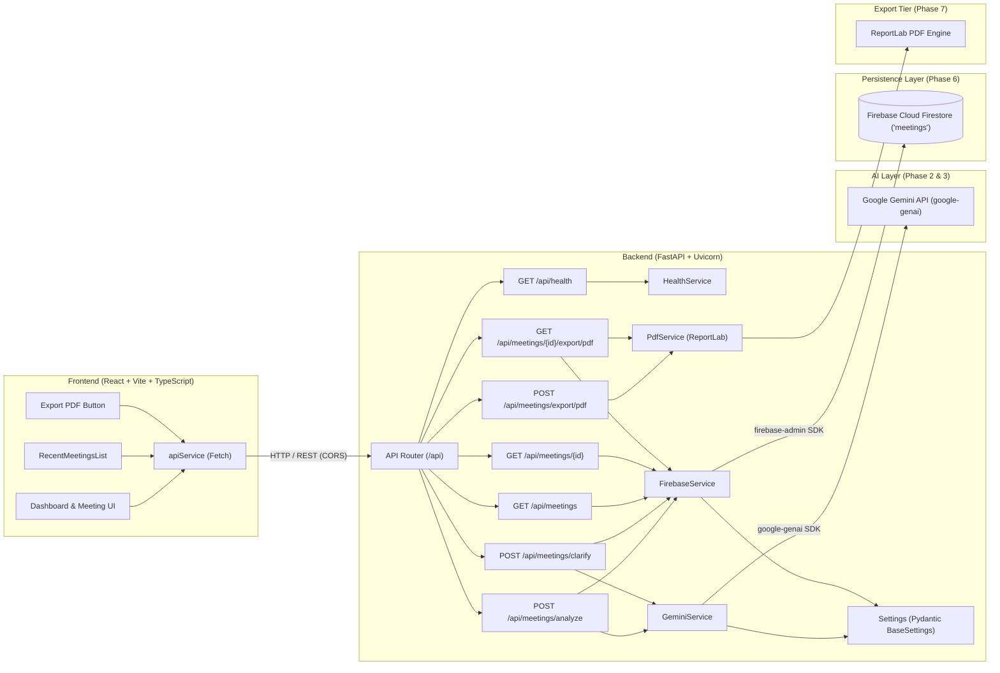

# MeetMind AI — AI-Powered Meeting-to-Action Assistant

[](https://fastapi.tiangolo.com/)
[](https://react.dev/)
[](https://www.typescriptlang.org/)
[](https://tailwindcss.com/)
[](https://ai.google.dev/)
[](https://firebase.google.com/)
[](https://www.reportlab.com/)
[](README.md)

**MeetMind AI** is an intelligent assistant engineered to bridge the gap between spoken or transcribed meeting conversations and structured execution. It converts raw, unstructured meeting transcripts into actionable summaries, decisions, explicit task ownership, strict deadlines, and clarifying questions—with full cloud persistence in Firebase Cloud Firestore and publication-grade PDF report exports.

Designed for college lab evaluation, MeetMind AI emphasizes clean architectural separation, production-ready standards, type safety, and maintainable software engineering principles.

---

## 1. Problem Statement

Modern teams spend substantial time in meetings, yet critical execution items often get lost in lengthy transcriptions or informal notes:
- **Information Overload**: Parsing multi-page transcripts to identify what was decided is inefficient.
- **Ambiguous Ownership**: Action items are frequently mentioned without clear owners (e.g., *"Someone should send the report"*).
- **Vague Deadlines**: Due dates are framed loosely without calendar context (e.g., *"Let's finish this by Friday"*).
- **Conflating Suggestions with Decisions**: Preliminary brainstorming (e.g., *"We should consider launching next month"*) is often incorrectly cataloged as a confirmed decision.
- **Incomplete Deliverables**: Key prerequisites and clarification questions often emerge only after work begins, causing avoidable delays.
- **Loss of Meeting History**: Stateless analysis tools force users to re-upload and re-analyze transcripts, losing past decisions and resolution progress.
- **Lack of Shareable Artifacts**: Teams need clean, printable, executive-ready PDF documentation to share agreed deliverables without forcing everyone into the database.

MeetMind AI automates the extraction and structuring of these elements, actively flags meaningful ambiguities, facilitates a structured clarification feedback loop, persists meetings in Cloud Firestore, and generates publication-grade PDF reports on demand.

---

## 2. Project Objectives

- **Automated Structuring**: Extract summaries, key discussion points, and critical decisions from conversational meeting text.
- **Ambiguity Detection**: Proactively identify and categorize missing owners, vague deadlines, ambiguous task scopes, and proposals vs. decisions.
- **Clarification Workflow**: Re-evaluate and refine meeting insights through targeted user feedback without hallucinating details.
- **Action Item Extraction**: Identify actionable tasks, assigned owners, and explicit or implicit deadlines with stable IDs.
- **Cloud Persistence**: Persist transcripts, generated intelligence, and ambiguity resolution history in Firebase Cloud Firestore.
- **Executive PDF Export**: Compile transcripts, decisions, tasks, and ambiguity logs into clean, multi-page PDF documents.
- **Clean Architecture**: Decouple client dashboard, API services, AI orchestration, cloud persistence, and PDF compilation tiers.

---

## 3. Technology Stack

### Frontend (Implemented in Phase 1, 4, 6 & 7)
- **Framework**: React 18 with Vite
- **Language**: TypeScript
- **Styling**: Tailwind CSS (Modern productivity UI with light/dark theme toggle, subtle borders, indigo accent)
- **Icons**: Lucide React
- **HTTP Client**: Centralized Fetch API client (`apiService`) with robust error classification and binary blob download handlers
- **Testing**: Native Node.js test runner (`node:test`, 16 automated unit tests)

### Backend (Implemented in Phase 1, 2, 3, 6 & 7)
- **Framework**: Python 3.11+ with FastAPI
- **Server**: Uvicorn (ASGI)
- **AI Integration**: Google Gemini API via official `google-genai` Python SDK
- **Model**: `gemini-2.5-flash` (configurable)
- **Database & Persistence**: Firebase Cloud Firestore via official `firebase-admin` Python SDK
- **PDF Compilation**: ReportLab (`reportlab>=4.2.0`) with custom two-pass canvas (`NumberedCanvas`) and auto-wrapping tables
- **Validation & Settings**: Pydantic v2 & `pydantic-settings`
- **Testing**: Pytest & HTTPX TestClient with mocked Gemini, Firestore, and PDF compiler calls (38 automated tests)
- **Middleware**: Fast CORS middleware configured for Vite development servers

---

## 4. Phase Status: Implemented vs. Planned

| Feature / Component | Status | Details |
| :--- | :---: | :--- |
| **Workspace & Repository Scaffold** | Completed | Clean monorepo structure separating `frontend/`, `backend/`, and `docs/`. |
| **Backend REST Health Check** | Completed | `GET /api/health` returns status and application metadata with CORS support. |
| **Backend Settings & Validation** | Completed | Pydantic v2 configuration management with environment variable loading. |
| **Client-Server Handshake** | Completed | Centralized `apiService` pings `/api/health` and displays real-time connection status. |
| **Gemini AI Backend Integration** | Completed | `POST /api/meetings/analyze` converts transcripts into structured JSON via `google-genai`. |
| **Anti-Hallucination Guardrails** | Completed | Extraction rules prevent inventing owners/deadlines; uses `null` for unassigned fields. |
| **Ambiguity Detection Engine** | Completed | Detects and tags ambiguities across ownership, deadlines, task scope, and proposals. |
| **Backend Clarification Endpoint** | Completed | `POST /api/meetings/clarify` updates analysis based on submitted clarification answers. |
| **Transcript Workspace (UI)** | Completed | Clean workspace with title input, live char/word counters, sample loaders, and validation. |
| **Analysis Loading State (UI)** | Completed | Multi-step progress indicator providing clear feedback during AI analysis and re-evaluation. |
| **Structured Results View (UI)** | Completed | Executive summary, discussion points, confirmed decisions, and action items with status tags. |
| **Interactive Clarification Cards (UI)** | Completed | In-place Q&A cards with category badges, input fields, and seamless re-evaluation without data loss. |
| **Light & Dark Theme Toggle (UI)** | Completed | Clean SaaS light theme (default) and dark mode with persistent `localStorage` synchronization. |
| **End-to-End Validation & Guardrails** | Completed | Live Gemini validation, root `/health` & `/api/health`, multi-answer batch submissions, and drop-prevention safeguards. |
| **Firebase Firestore Persistence** | Completed | Cloud Firestore integration via `firebase-admin`, document storage, list recent meetings, detail retrieval, and in-place updates. |
| **Meeting History & Reopen UI** | Completed | History tab and sidebar meeting list, one-click meeting reopening, transcript viewer toggle, and "New Meeting" reset. |
| **PDF Meeting Report Export** | Completed | Publication-grade server-side PDF generator using ReportLab with multi-page handling, safe filename sanitization, and browser download actions. |
| **Final Validation, Docs & Viva Prep** | **Completed (Phase 8)** | Full test coverage (38 backend, 16 frontend), zero-credential test suite, clean build, and 25-question technical viva preparation guide. |

---

## 5. System Architecture & Ambiguity Workflow



---

## 6. Project Structure

```text
meetmind-ai/
│
├── frontend/
│   ├── public/                 # Static assets
│   ├── src/
│   │   ├── components/         # Reusable UI components
│   │   │   ├── AnalysisLoadingState.tsx # Step-by-step processing state
│   │   │   ├── AnalysisResults.tsx      # Executive summaries, actions, decisions & Export PDF action
│   │   │   ├── ClarificationSection.tsx # In-place ambiguity resolution cards
│   │   │   ├── EmptyState.tsx           # Initial placeholder & guidance
│   │   │   ├── Header.tsx               # Top navigation & backend status pill
│   │   │   ├── RecentMeetingsList.tsx   # History list (compact & grid modes with quick PDF download)
│   │   │   ├── Sidebar.tsx              # Sidebar navigation, history & theme toggle
│   │   │   ├── StatsCard.tsx            # Key metric summary indicators
│   │   │   └── TranscriptWorkspace.tsx  # Input textarea, counters & presets
│   │   ├── pages/              # View pages (Dashboard & History)
│   │   │   └── Dashboard.tsx
│   │   ├── services/           # Centralized API service
│   │   │   └── api.ts          # REST endpoints (health, analyze, clarify, list, get, export PDF)
│   │   ├── types/              # TypeScript interfaces & types
│   │   │   └── index.ts        # Pydantic-mirrored data contracts
│   │   ├── App.tsx             # Root component with state orchestrator
│   │   ├── index.css           # Tailwind directives & theme styling
│   │   ├── main.tsx            # React DOM entrypoint
│   │   └── vite-env.d.ts       # Vite environment type declarations
│   ├── tests/
│   │   └── api.test.mjs        # Frontend unit tests (16 tests via node:test)
│   ├── .env.example            # Client environment variable template
│   ├── index.html              # HTML entrypoint
│   ├── package.json            # Frontend dependencies & build scripts
│   ├── postcss.config.js       # PostCSS configuration for Tailwind
│   ├── tailwind.config.js      # Tailwind configuration with brand theme
│   ├── tsconfig.json           # TypeScript project references
│   ├── tsconfig.app.json       # App TypeScript configuration
│   ├── tsconfig.node.json      # Node TypeScript configuration
│   └── vite.config.ts          # Vite configuration
│
├── backend/
│   ├── app/
│   │   ├── api/
│   │   │   ├── routes/
│   │   │   │   ├── __init__.py
│   │   │   │   ├── health.py   # GET /api/health route
│   │   │   │   └── meetings.py # POST /analyze, POST /clarify, GET /meetings, GET /meetings/{id}, POST /export/pdf, GET /{id}/export/pdf
│   │   │   ├── __init__.py
│   │   │   └── router.py       # API router registration
│   │   ├── core/
│   │   │   ├── __init__.py
│   │   │   └── config.py       # Pydantic BaseSettings (Gemini & Firebase config)
│   │   ├── schemas/
│   │   │   ├── __init__.py
│   │   │   ├── health.py       # Health response schemas
│   │   │   └── meeting.py      # Meeting, Clarification & PDF Export schemas
│   │   ├── services/
│   │   │   ├── __init__.py
│   │   │   ├── firebase_service.py # Firestore persistence & lifecycle management
│   │   │   ├── gemini_service.py   # Gemini extraction, ambiguity detection & re-evaluation
│   │   │   ├── health_service.py   # Health check business logic
│   │   │   └── pdf_service.py      # ReportLab PDF compiler & NumberedCanvas engine
│   │   ├── __init__.py
│   │   └── main.py             # FastAPI entrypoint, lifespan context, middleware, errors
│   ├── tests/
│   │   ├── __init__.py
│   │   ├── test_firebase.py    # Firestore persistence test suite (8 tests)
│   │   ├── test_health.py      # Health & CORS test suite (4 tests)
│   │   ├── test_meetings.py    # Meeting analysis & Clarification test suite (18 tests)
│   │   └── test_pdf_export.py  # PDF export & layout test suite (8 tests)
│   ├── .env.example            # Backend environment variable template
│   └── requirements.txt        # Python dependencies (google-genai, firebase-admin, reportlab)
│
├── docs/
│   └── architecture.md         # System design, persistence, PDF tier & clarification workflow
│
├── .gitignore                  # Git exclusion rules (keys, secrets, venv, node_modules)
└── README.md                   # Comprehensive project documentation
```

---

## 7. Environment Variables Configuration

Both the frontend and backend utilize `.env.example` templates. **Never commit actual `.env` files or Firebase service account JSON files with secret keys.**

### Backend (`backend/.env.example`)

```env
# Gemini AI Configuration
GEMINI_API_KEY=your_gemini_api_key_here
GEMINI_MODEL=gemini-2.5-flash

# Firebase Cloud Firestore Configuration
FIREBASE_PROJECT_ID=your-firebase-project-id
# Path to downloaded serviceAccountKey.json file:
FIREBASE_CREDENTIALS_PATH=serviceAccountKey.json
# Or paste raw service account JSON string:
FIREBASE_CREDENTIALS_JSON=
FIRESTORE_COLLECTION_MEETINGS=meetings
```

### Frontend (`frontend/.env.example`)

```env
VITE_API_BASE_URL=http://localhost:8000
```

---

## 8. API Specification

### 8.1 Analyze Meeting Transcript
`POST /api/meetings/analyze`

**Request Body**:
```json
{
  "title": "Mobile App Redesign Sync",
  "transcript": "Sarah: Let us review the blockers for the milestone release.\nDavid: The Figma tokens are ready. I need Alex to confirm the GraphQL schema by Wednesday 4 PM.\nAlex: I will finalize the endpoint by Wednesday 4 PM once security signs off.\nPriya: We need test credentials for the staging sandbox. Someone should provision them by tomorrow morning."
}
```

**Response Body**:
```json
{
  "meeting_id": "meet_a1b2c3d4e5f6",
  "summary": "The team aligned on the mobile app redesign milestones and identified staging access requirements.",
  "discussion_points": [
    "Figma design system token handoff from David",
    "GraphQL schema updates for user preferences",
    "Staging sandbox test credentials requirement"
  ],
  "decisions": [
    "Alex will finalize GraphQL endpoints by Wednesday at 4 PM"
  ],
  "action_items": [
    {
      "id": "action_1",
      "task": "Confirm and finalize GraphQL schema changes for user preferences",
      "owner": "Alex",
      "deadline": "Wednesday 4 PM",
      "status": "pending"
    },
    {
      "id": "action_2",
      "task": "Provision test credentials for the staging sandbox",
      "owner": null,
      "deadline": "Tomorrow morning",
      "status": "pending"
    }
  ],
  "clarification_required": true,
  "clarification_question": "Who is specifically responsible for provisioning the staging sandbox test credentials by tomorrow morning?",
  "clarifications": [
    {
      "id": "clarif_1",
      "category": "ownership",
      "original_statement": "Someone should provision them by tomorrow morning.",
      "explanation": "No specific individual or team was assigned to provision staging access.",
      "question": "Who is specifically responsible for provisioning the staging sandbox test credentials by tomorrow morning?",
      "related_action_item_id": "action_2",
      "resolved": false
    }
  ]
}
```

---

### 8.2 Submit Clarification Answers
`POST /api/meetings/clarify`

Submits answers to open clarification questions. The backend re-evaluates the analysis, updates the action items, and updates the Firestore document in-place.

---

### 8.3 List Recent Meetings
`GET /api/meetings?limit=20`

Returns a chronological list of recent saved meetings from Cloud Firestore.

---

### 8.4 Get Meeting Details
`GET /api/meetings/{meeting_id}`

Retrieves the full record for a previously saved meeting, including its raw transcript, complete structured analysis, and clarification revision history.

---

### 8.5 Export Active/Unsaved Meeting as PDF
`POST /api/meetings/export/pdf`

Compiles the provided meeting analysis, transcript, and metadata into a publication-grade PDF report and streams it as a binary download.

**Request Body**:
```json
{
  "title": "Mobile App Redesign Sync",
  "transcript": "Sarah: Let us review the blockers...",
  "analysis": { ... },
  "answers_history": [ ... ]
}
```

**Response**:
- Status: `200 OK`
- Header: `Content-Type: application/pdf`
- Header: `Content-Disposition: attachment; filename="meetmind_mobile_app_redesign_sync.pdf"`
- Body: Binary PDF stream

---

### 8.6 Export Saved Meeting as PDF
`GET /api/meetings/{meeting_id}/export/pdf`

Fetches a persisted meeting from Cloud Firestore and compiles it into a downloadable PDF report.

**Response**:
- Status: `200 OK`
- Header: `Content-Type: application/pdf`
- Header: `Content-Disposition: attachment; filename="meetmind_meet_a1b2c3d4e5f6.pdf"`
- Body: Binary PDF stream

---

## 9. PDF Report Design & Structure

The PDF report generated by MeetMind AI is structured into six clean executive sections:
1. **Header & Metadata Grid**: MeetMind AI branding badge, meeting title, report creation timestamp, meeting ID, and ambiguity resolution status.
2. **Executive Summary Callout**: Highlighted card with Indigo accent bar presenting the core takeaways.
3. **Discussion Topics & Confirmed Decisions**: Bulleted discussion items alongside verified decisions highlighted with green checkmarks.
4. **Assigned Action Items & Deliverables Table**: Multi-column table with header shading (`#1E293B`), alternate row backgrounds, and explicit badges for assigned owners, target deadlines, and statuses. Unassigned owners (`Unassigned`) and missing deadlines (`None specified`) are styled in muted warning colors.
5. **Ambiguity Detection & Clarification Audit Log**: Complete history of flagged ambiguities, categories (`ownership`, `deadline`, `task_scope`), transcript context, and submitted resolution answers.
6. **Source Meeting Transcript**: Full transcript audit record formatted into sequential rows that break across multiple pages cleanly without clipping.
7. **Two-Pass Numbered Canvas**: Running headers on pages > 1 and footers on all pages with `"Page X of Y"` and generated timestamps.

---

## 10. Installation & Run Guide

### Prerequisites
- **Node.js**: v18+ (tested on Node v26)
- **npm**: v9+ (tested on npm 11)
- **Python**: 3.11+
- **Google Gemini API Key**: Obtainable from [Google AI Studio](https://aistudio.google.com/)
- **Firebase Project**: Service account credentials configured as described in `backend/.env`

---

### Backend Setup

1. **Navigate to the backend directory**:
   ```bash
   cd backend
   ```

2. **Create and activate a virtual environment**:
   ```bash
   python3 -m venv .venv
   source .venv/bin/activate    # On macOS/Linux
   # or: .venv\Scripts\activate # On Windows
   ```

3. **Install dependencies**:
   ```bash
   pip install -r requirements.txt
   ```

4. **Run the complete automated test suite (38 tests)**:
   ```bash
   pytest -v tests/
   ```

5. **Start the FastAPI server**:
   ```bash
   uvicorn app.main:app --reload --host 0.0.0.0 --port 8000
   ```

The backend server is accessible at `http://localhost:8000`.
- Health Endpoint: `http://localhost:8000/api/health`
- Meeting Analysis Endpoint: `http://localhost:8000/api/meetings/analyze`
- Clarification Resolution Endpoint: `http://localhost:8000/api/meetings/clarify`
- Meeting History Endpoint: `http://localhost:8000/api/meetings`
- PDF Export Endpoint: `http://localhost:8000/api/meetings/export/pdf`
- Interactive Swagger Docs: `http://localhost:8000/docs`

---

### Frontend Setup

1. **Navigate to the frontend directory**:
   ```bash
   cd frontend
   ```

2. **Install dependencies**:
   ```bash
   npm install
   ```

3. **Run automated unit tests (16 tests)**:
   ```bash
   npm test
   ```

4. **Type-check and build the production bundle**:
   ```bash
   npm run build
   ```

5. **Start the Vite development server**:
   ```bash
   npm run dev
   ```

The frontend dashboard will be available at `http://localhost:5173`.

---

## 11. Development Roadmap

- [x] **Phase 1: Project Foundation & Handshake**
  - Project architecture & directory structure
  - FastAPI server with health check & CORS
  - React + TypeScript + Tailwind CSS dashboard UI
  - Real-time client-to-server health handshake
  - Clean Git repository setup and comprehensive documentation
- [x] **Phase 2: Google Gemini AI Integration**
  - Integrate official `google-genai` Python SDK
  - Pydantic schema contracts for `MeetingAnalysisRequest` and `MeetingAnalysisResponse`
  - Anti-hallucination prompt engineering (enforce `null` for unstated owners/deadlines)
  - Robust JSON parsing with markdown-fence sanitization
  - Comprehensive unit test suite with mocked Gemini calls
- [x] **Phase 3: Ambiguity Detection & Clarification Workflow**
  - Detect ambiguous ownership, deadlines, task scope, and decision vs. suggestion
  - Structured `clarifications` data model with stable IDs and category tags
  - Interactive clarification re-evaluation endpoint (`POST /api/meetings/clarify`)
  - Safe, non-destructive updating of action items and decisions
  - Comprehensive test suite covering 19 test scenarios
- [x] **Phase 4: Frontend UI Implementation**
  - Full-featured transcript input workspace with title, character/word counters, sample loaders, and input clearing
  - Multi-step loading state with visual progress steps during analysis and re-evaluation
  - Structured results rendering: Executive summary, discussion points, confirmed decisions, and action items
  - Action items with explicit status tags and clear indicators for unassigned owners and missing deadlines
  - Interactive clarification workflow with categorized ambiguity cards (`ownership`, `deadline`, `task_scope`, `decision_vs_suggestion`, `missing_context`)
  - Seamless in-place re-evaluation via `POST /api/meetings/clarify` with inline error recovery and state preservation
  - Dual theme architecture: clean, high-contrast light productivity theme (default) + dark theme with `localStorage` persistence
  - Live backend heartbeat connectivity pill and responsive multi-device navigation
- [x] **Phase 5: End-to-End Integration & Validation**
  - Full end-to-end integration verified via automated test suites and live Google Gemini API calls
  - Dual health endpoints supported (`GET /health` and `GET /api/health`) for maximum ecosystem compatibility
  - Multi-answer batch clarification submission in frontend and backend
  - Non-destructive post-processing guardrails preserving unrelated action items, decisions, and unaddressed ambiguities
  - 60-second AbortController request timeout and network resilience handling
  - Frontend integration test suite with native `node:test` (`npm test`, 8/8 tests passing)
  - 22 backend automated tests (`pytest`, 22/22 tests passing)
- [x] **Phase 6: Firebase Firestore Persistence & Meeting History**
  - Cloud Firestore integration via official `firebase-admin` Python SDK
  - Safe singleton `FirebaseService` with support for service account JSON files, raw env strings, and ADC
  - Zero mock credential requirements: 100% mocked Firestore client in automated test suite
  - Meeting persistence lifecycle: automatic ID generation, timestamps, analysis storage, and clarification audit logging
  - In-place Firestore updates on clarification submission preventing duplicate records
  - REST endpoints: `GET /api/meetings` (recent listing) and `GET /api/meetings/{id}` (detail retrieval)
  - Frontend Recent Meetings panel (Sidebar compact view and Dashboard history view)
  - Reopening of previously analyzed meetings with full state restoration (transcript, decisions, actions, ambiguities)
  - "New Meeting" reset flow for clean workspace reuse
  - 30 backend automated tests and 12 frontend unit tests passing
- [x] **Phase 7: PDF Meeting Report Export**
  - Server-side PDF report compilation engine using ReportLab (`reportlab>=4.2.0`)
  - Publication-grade multi-page document layout with two-pass `NumberedCanvas` ("Page X of Y")
  - Structured sections: Branding header, Executive summary callout, Discussion topics, Decisions, Action items table, and Clarification audit log
  - Source meeting transcript appendix with page-split flowables preventing overflow
  - Safe filename sanitization (`meetmind_{slug}.pdf`) with character filtering and truncation
  - In-memory binary generation (`io.BytesIO`) without temporary disk files
  - REST endpoints: `POST /api/meetings/export/pdf` (active analysis) and `GET /api/meetings/{id}/export/pdf` (saved meeting)
  - Frontend "Export PDF" button in workspace results header and quick-export icons on history cards
  - 38 backend automated tests and 16 frontend unit tests passing
- [x] **Phase 8: Final Validation, Documentation & Viva Preparation**
  - Full backend test suite passing (38/38 tests across health, Gemini, clarifications, Firestore, and PDF export)
  - Full frontend test suite passing (16/16 unit tests via `node:test`, zero TypeScript errors, clean Vite production build)
  - Rigorous security and configuration audit: verified zero credentials or keys in Git; robust `.gitignore` enforcement
  - Version bump to production standard `v1.0.0` across backend configuration and UI navigation badge
  - Production-ready Viva Preparation Guide ([docs/VIVA_PREPARATION.md](docs/VIVA_PREPARATION.md)) including 1-minute elevator pitch, architectural breakdown, anti-hallucination analysis, testing philosophy, 25 technical viva Q&As, and step-by-step live demo script
