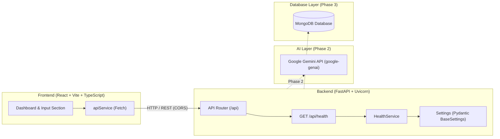

# MeetMind AI — AI-Powered Meeting-to-Action Assistant

[](https://fastapi.tiangolo.com/)
[](https://react.dev/)
[](https://www.typescriptlang.org/)
[](https://tailwindcss.com/)
[](README.md)

**MeetMind AI** is an intelligent assistant engineered to bridge the gap between spoken or transcribed meeting conversations and structured execution. It converts raw, unstructured meeting transcripts into actionable summaries, decisions, explicit task ownership, strict deadlines, and clarifying questions.

Designed for college lab evaluation, MeetMind AI emphasizes clean architectural separation, production-ready standards, type safety, and maintainable software engineering principles.

---

## 1. Problem Statement

Modern teams spend substantial time in meetings, yet critical execution items often get lost in lengthy transcriptions or informal notes:
- **Information Overload**: Parsing multi-page transcripts to identify what was decided is inefficient.
- **Ambiguous Ownership**: Action items are frequently mentioned without clear owners or deadlines.
- **Incomplete Deliverables**: Key prerequisites and clarification questions often emerge only after work begins, causing avoidable delays.

MeetMind AI automates the extraction and structuring of these elements, turning passive transcripts into an active, traceable execution checklist.

---

## 2. Project Objectives

- **Automated Structuring**: Extract summaries, key discussion points, and critical decisions from conversational meeting text.
- **Action Item Extraction**: Identify actionable tasks, assigned owners, and explicit or implicit deadlines.
- **Proactive Clarification**: Formulate clarifying questions for incomplete, vague, or ambiguous tasks before execution starts.
- **Clean Architecture**: Decouple the client dashboard, API services, AI orchestration, and persistent storage.

---

## 3. Technology Stack

### Frontend (Implemented in Phase 1)
- **Framework**: React 18 with Vite
- **Language**: TypeScript
- **Styling**: Tailwind CSS (Dark navy/slate theme with indigo accents)
- **Icons**: Lucide React
- **HTTP Client**: Centralized Fetch API client (`apiService`)

### Backend (Implemented in Phase 1)
- **Framework**: Python 3.11+ with FastAPI
- **Server**: Uvicorn (ASGI)
- **Validation & Settings**: Pydantic v2 & `pydantic-settings`
- **Testing**: Pytest & HTTPX TestClient
- **Middleware**: Fast CORS middleware configured for Vite development servers

### AI & Data Layers (Reserved for Future Phases)
- **AI Engine (Phase 2)**: Google Gemini API using official Python SDK (`google-genai`)
- **Database (Phase 3)**: MongoDB for persistent meeting records and action items

---

## 4. Phase Status: Implemented vs. Planned

| Feature / Component | Status | Details |
| :--- | :---: | :--- |
| **Workspace & Repository Scaffold** | Completed | Clean monorepo structure separating `frontend/`, `backend/`, and `docs/`. |
| **Backend REST Health Check** | Completed | `GET /api/health` returns status and application metadata with CORS support. |
| **Backend Settings & Validation** | Completed | Pydantic v2 configuration management with environment variable loading. |
| **Frontend Dashboard UI** | Completed | Modern dark navy/slate dashboard with sidebar, stats cards, and meeting input. |
| **Client-Server Handshake** | Completed | Centralized `apiService` pings `/api/health` and displays real-time connection status. |
| **Transcript Input Form** | Completed | Title, transcript textarea with word/character counter, and sample transcript loader. |
| **Gemini AI Integration** | *Planned (Phase 2)* | Extraction of summaries, decisions, action items, and clarification queries. |
| **MongoDB Database Storage** | *Planned (Phase 3)* | Persistent storage for meeting archives, action item statuses, and user settings. |

---

## 5. System Architecture



---

## 6. Project Structure

```text
meetmind-ai/
│
├── frontend/
│   ├── public/                 # Static assets
│   ├── src/
│   │   ├── components/         # Reusable UI components
│   │   │   ├── ConnectionBanner.tsx
│   │   │   ├── EmptyState.tsx
│   │   │   ├── Header.tsx
│   │   │   ├── NewMeetingSection.tsx
│   │   │   ├── Sidebar.tsx
│   │   │   └── StatsCard.tsx
│   │   ├── pages/              # View pages (Dashboard)
│   │   │   └── Dashboard.tsx
│   │   ├── services/           # Centralized API service
│   │   │   └── api.ts
│   │   ├── types/              # TypeScript interfaces & types
│   │   │   └── index.ts
│   │   ├── App.tsx             # Root component with health polling
│   │   ├── index.css           # Tailwind directives & theme styling
│   │   ├── main.tsx            # React DOM entrypoint
│   │   └── vite-env.d.ts       # Vite environment type declarations
│   ├── .env.example            # Client environment variable template
│   ├── index.html              # HTML entrypoint
│   ├── package.json            # Frontend dependencies & build scripts
│   ├── postcss.config.js       # PostCSS configuration for Tailwind
│   ├── tailwind.config.js      # Tailwind configuration with brand theme
│   ├── tsconfig.json           # TypeScript project references
│   ├── tsconfig.app.json       # App TypeScript configuration
│   ├── tsconfig.node.json      # Node TypeScript configuration
│   └── vite.config.ts          # Vite configuration
│
├── backend/
│   ├── app/
│   │   ├── api/
│   │   │   ├── routes/
│   │   │   │   ├── __init__.py
│   │   │   │   └── health.py   # GET /api/health route
│   │   │   ├── __init__.py
│   │   │   └── router.py       # API router registration
│   │   ├── core/
│   │   │   ├── __init__.py
│   │   │   └── config.py       # Pydantic BaseSettings & CORS logic
│   │   ├── schemas/
│   │   │   ├── __init__.py
│   │   │   └── health.py       # Pydantic schemas for health responses
│   │   ├── services/
│   │   │   ├── __init__.py
│   │   │   └── health_service.py # Health check business logic
│   │   ├── __init__.py
│   │   └── main.py             # FastAPI entrypoint, middleware, errors
│   ├── tests/
│   │   ├── __init__.py
│   │   └── test_health.py      # Pytest test suite for health & CORS
│   ├── .env.example            # Backend environment variable template
│   └── requirements.txt        # Python dependencies
│
├── docs/
│   └── architecture.md         # System design & architecture details
│
├── .gitignore                  # Comprehensive Git exclusion rules
└── README.md                   # Project documentation
```

---

## 7. Environment Variables Configuration

Both the frontend and backend utilize `.env.example` templates. **Never commit actual `.env` files with secret keys.**

### Backend (`backend/.env.example`)

```env
GEMINI_API_KEY=your_gemini_api_key_here
GEMINI_MODEL=your_selected_gemini_model
MONGODB_URI=mongodb://localhost:27017
DATABASE_NAME=meetmind_ai
```

### Frontend (`frontend/.env.example`)

```env
VITE_API_BASE_URL=http://localhost:8000
```

To configure local environments:
```bash
# Backend
cp backend/.env.example backend/.env

# Frontend
cp frontend/.env.example frontend/.env
```

---

## 8. Installation & Setup Guide

### Prerequisites
- **Node.js**: v18+ (tested on Node v26)
- **npm**: v9+ (tested on npm 11)
- **Python**: 3.11+
- **Git**

---

### Backend Setup

1. **Navigate to the backend directory**:
   ```bash
   cd backend
   ```

2. **Create and activate a virtual environment**:
   ```bash
   python3 -m venv .venv
   source .venv/bin/activate    # On macOS/Linux
   # or: .venv\Scripts\activate # On Windows
   ```

3. **Install dependencies**:
   ```bash
   pip install -r requirements.txt
   ```

4. **Run unit tests**:
   ```bash
   pytest tests/
   ```

5. **Start the FastAPI server**:
   ```bash
   uvicorn app.main:app --reload --host 0.0.0.0 --port 8000
   ```

The backend server is accessible at `http://localhost:8000`.
- Health Endpoint: `http://localhost:8000/api/health`
- Interactive Swagger Docs: `http://localhost:8000/docs`
- ReDoc Docs: `http://localhost:8000/redoc`

---

### Frontend Setup

1. **Navigate to the frontend directory**:
   ```bash
   cd frontend
   ```

2. **Install dependencies**:
   ```bash
   npm install
   ```

3. **Build the production bundle (type check + build)**:
   ```bash
   npm run build
   ```

4. **Start the Vite development server**:
   ```bash
   npm run dev
   ```

The frontend dashboard will be available at `http://localhost:5173`.

---

## 9. Running Frontend and Backend Concurrently

For optimal evaluation, open two terminal windows:

**Terminal 1 (Backend)**:
```bash
cd backend
source .venv/bin/activate
uvicorn app.main:app --reload --port 8000
```

**Terminal 2 (Frontend)**:
```bash
cd frontend
npm run dev
```

Visit `http://localhost:5173` in your browser. The dashboard will automatically detect the backend and display **"Backend: Online (200 OK)"** with an active emerald indicator.

---

## 10. GitHub Setup & Remote Connection

If you are cloning this repository or pushing to an existing GitHub repository, use the following commands:

```bash
# Add your GitHub repository as the remote
git remote add origin <YOUR_GITHUB_REPOSITORY_URL>

# Push to the main branch
git push -u origin main
```

---

## 11. Development Roadmap

- [x] **Phase 1: Project Foundation & Handshake**
  - Project architecture & directory structure
  - FastAPI server with health check & CORS
  - React + TypeScript + Tailwind CSS dashboard UI
  - Real-time client-to-server health handshake
  - Clean Git repository setup and comprehensive documentation
- [ ] **Phase 2: Google Gemini AI Integration**
  - Integrate `google-genai` SDK
  - Prompt engineering for structured extraction (summaries, decisions, action items, deadlines)
  - Proactive clarification query generation for ambiguous tasks
  - Pydantic response models for structured outputs
- [ ] **Phase 3: Database & Persistence Layer**
  - MongoDB connection and schema definitions
  - Meeting transcript archiving and retrieval
  - Action item status tracking (pending, completed, blocked)
- [ ] **Phase 4: Advanced Features & Export**
  - Export action items to markdown / CSV / Jira format
  - Audio transcript upload / speech-to-text pipeline
  - Analytics and team velocity metrics
