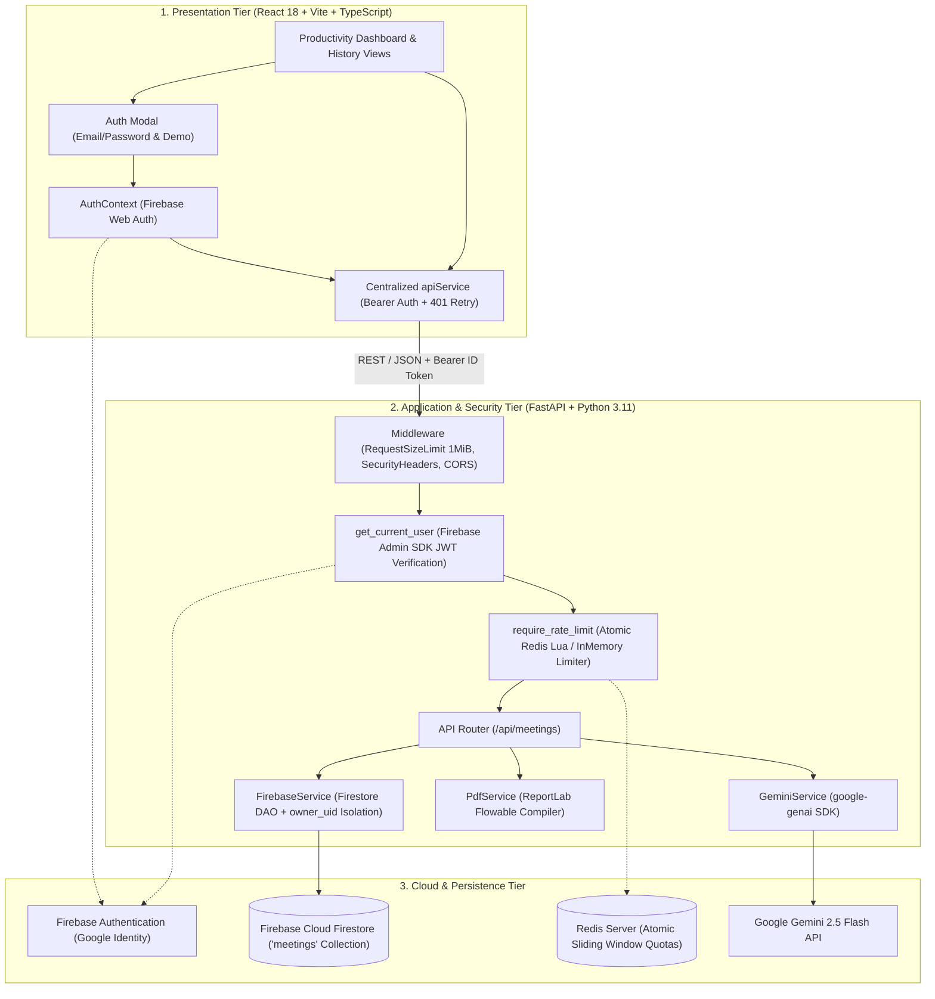

# MeetMind AI — Viva & Technical Evaluation Guide

This guide is designed for Computer Science & Engineering (AI/ML/Software Engineering) students defending **MeetMind AI: AI-Powered Meeting-to-Action Assistant** during project evaluations, lab assessments, and technical viva voce examinations.

---

## 1. Executive Summary & 1-Minute Elevator Pitch

> *"Good morning, esteemed examiners. **MeetMind AI** is an enterprise-grade full-stack system engineered to eliminate the gap between spoken meeting dialogues and structured project execution.*
>
> *While traditional transcription tools merely convert audio into large walls of unstructured text, MeetMind AI analyzes raw meeting transcripts using Google Gemini 2.5 Flash to automatically extract executive summaries, discussion points, confirmed decisions, and structured action items with assigned owners and deadlines.*
>
> *Crucially, unlike standard conversational chatbots that hallucinate or silently assign tasks, MeetMind AI features a dedicated **ambiguity detection and clarification feedback loop**. It proactively flags unassigned tasks, vague deadlines, or mere brainstorming suggestions using a 4-way classification strategy, allowing users to resolve them in-place with non-destructive merge safeguards.*
>
> *The platform implements end-to-end multi-user security with **Firebase Authentication** on the client, cryptographic **Firebase Admin SDK** Bearer token verification on the backend, and strict **`owner_uid` document isolation** in Cloud Firestore. Resource exhaustion and billable API abuse are prevented via a distributed sliding-window rate limiter powered by an **atomic Redis Lua script** and defensive payload-bounding middleware.*
>
> *Finally, MeetMind AI compiles publication-grade, multi-page meeting reports via a server-side **ReportLab PDF engine** using an in-memory two-pass `NumberedCanvas`.*
>
> *The system is built with React 18, Vite, TypeScript, and Tailwind CSS on the frontend, and Python 3.11 with FastAPI on the backend, validated by 99 automated backend tests and 32 frontend unit tests."*

---

## 2. Problem Statement & Key Objectives

### The Problem
In modern software engineering and business operations, teams spend significant hours in syncs, sprint planning, and architectural reviews:
1. **Information Overload**: Teams generate multi-page conversational transcripts where key takeaways are buried.
2. **Ambiguous Ownership**: Action items are spoken without explicit owners (e.g., *"Someone should update the documentation"*).
3. **Vague Deadlines**: Due dates are framed colloquially without calendar context (e.g., *"Let's try to wrap this up by Friday"*).
4. **Suggestion vs. Decision Conflation**: Brainstorming proposals (e.g., *"We should consider migrating to Rust"*) are frequently miscataloged as binding decisions.
5. **Loss of Session History**: Stateless AI analysis tools force users to re-submit transcripts, losing resolution history.
6. **Data Privacy & Multi-Tenancy**: Unsecured systems allow anyone to view or tamper with other users' confidential meeting minutes.
7. **API Abuse & Billable Quota Exhaustion**: Downstream AI endpoints are vulnerable to denial-of-service and credential scraping if unauthenticated and unthrottled.

### The Objectives
- **Accurate Automated Extraction**: Extract clean summaries, discussion topics, confirmed decisions, and action items.
- **Strict Anti-Hallucination Guardrails**: If an owner or deadline is unmentioned, store it strictly as `null` rather than guessing.
- **Ambiguity Detection & Targeted Clarification**: Detect missing parameters, formulate targeted questions, and re-evaluate affected items without dropping unrelated tasks.
- **Multi-User Security & Isolation**: Authenticate users via Firebase Authentication, verify Bearer JWTs, and strictly partition Firestore records by `owner_uid`.
- **Abuse & Rate Limit Protection**: Enforce atomic per-user sliding-window rate limits and payload byte ceilings.
- **Professional Artifact Generation**: Compile multi-page, publication-grade executive PDFs for stakeholder distribution without writing temporary files to server disks.

---

## 3. System Architecture & End-to-End Request Flow

### 3.1 Three-Tier Decoupled Architecture

### 3.2 End-to-End Execution Sequence
1. **Authentication & Session Initialization**:
   - User signs in with Email/Password or clicks *"Explore Demo Account"* (which authenticates via `signInAnonymously`).
   - The Firebase Web SDK issues a cryptographically signed ID token (JWT) cached in IndexedDB.
2. **Transcript Ingestion & AI Analysis (`POST /api/meetings/analyze`)**:
   - `RequestSizeLimitMiddleware` verifies the payload is under 1 MiB.
   - `get_current_user` validates the Bearer token with Firebase Admin SDK, extracting caller `uid`.
   - `require_rate_limit` verifies the caller has not exceeded the 10 req/min quota via an atomic Redis Lua check.
   - `GeminiService` constructs a prompt with strict anti-hallucination guardrails and generates structured JSON.
   - `FirebaseService` generates a collision-resistant `meeting_id` and persists the document tagged with `owner_uid: current_user.uid`.
   - Structured results render immediately in the UI.
3. **Ambiguity Resolution (`POST /api/meetings/clarify`)**:
   - The user answers open clarification questions.
   - The backend validates ownership of `meeting_id` against `current_user.uid`.
   - `GeminiService` re-evaluates the analysis, updating affected action items while preserving unrelated items.
   - `FirebaseService` executes an atomic in-place `doc_ref.update()` in Firestore, appending answers to `answers_history`.
4. **Meeting Reopening & Deletion (`GET /api/meetings`, `GET /{id}`, `DELETE /{id}`)**:
   - History panel fetches meetings filtered strictly by `owner_uid == current_user.uid`.
   - Access to any meeting owned by another user returns `404 Not Found` (preventing ID enumeration).
   - Deletion removes the document permanently from Cloud Firestore with soft modal confirmation.
5. **PDF Export (`POST /export/pdf` or `GET /{id}/export/pdf`)**:
   - `PdfService` parses the meeting analysis into ReportLab flowables.
   - The custom two-pass `NumberedCanvas` compiles the document in-memory (`io.BytesIO`).
   - The binary stream is served with safe filename headers (`meetmind_{slug}.pdf`).

---

## 4. Technical Justifications (Why This Stack?)

| Technology | Role | Why Chosen? | Key Alternatives Considered & Rejected |
| :--- | :--- | :--- | :--- |
| **React 18 + Vite** | Frontend Framework | Instant HMR, component reusability, lightweight bundle size, and fast client navigation. | *Create React App* (deprecated, sluggish), *Next.js* (unnecessary server-side rendering complexity for an authenticated SPA). |
| **TypeScript 5** | Language | End-to-end type safety preventing runtime schema mismatches between API responses and UI state. | *Vanilla JavaScript* (prone to `undefined` errors when traversing nested AI outputs). |
| **Tailwind CSS** | Styling System | Rapid utility-first styling, zero CSS runtime overhead, seamless dark/light mode toggle via CSS variables. | *Bootstrap / Material UI* (heavyweight runtime CSS, inflexible abstractions). |
| **FastAPI** | Backend Framework | High-performance asynchronous ASGI execution, native Pydantic v2 validation, automated OpenAPI docs. | *Flask* (lacks native async, manual schema parsing), *Django* (monolithic, heavy for microservices). |
| **Google Gemini 2.5 Flash** | AI Engine | 1M token context window, sub-second latency, high token throughput, cost efficiency, structured JSON adherence. | *Gemini 1.5 Pro* (slower latency for interactive syncs), *OpenAI GPT-4o* (higher cost, outside GCP ecosystem). |
| **Firebase Authentication** | Identity & Access | Managed authentication supporting Email/Password and Anonymous sessions with Google-signed JWTs. | *Custom JWT Auth* (requires building secure refresh rotation, token blacklists, password hashing). |
| **Firebase Cloud Firestore** | Database | Serverless NoSQL document model matching JSON schemas naturally, zero DB administration, official Python SDK. | *MongoDB* (requires cluster hosting/credentials management), *PostgreSQL* (relational schema requires relational table mapping for nested clarifications). |
| **Redis (Lua Limiter)** | Distributed Rate Limiting | In-memory atomic sliding window execution; prevents race conditions and over-quota bursts across backend workers. | *Nginx limit_req* (coarse IP-based limiting, cannot limit by verified Firebase user identity). |
| **ReportLab** | PDF Generation Engine | Programmatic, high-precision layout control, native page-budgeting canvas (`NumberedCanvas`), in-memory streaming. | *Weasyprint / wkhtmltopdf* (requires headless Chromium / system C-library dependencies, difficult to containerize). |

---

## 5. Deep-Dive: Core Mechanisms

### 5.1 The Anti-Hallucination & Ambiguity Architecture
Large Language Models tend to make assumptions when presented with incomplete facts. For instance, if a transcript says *"We should fix the login bug soon"*, generic models often invent a fictitious deadline (e.g., *"Friday"*) or assign it to whoever spoke last.

**MeetMind AI solves this using a four-way classification strategy:**
1. **Needs Clarification**: Required task details are missing or unclear (e.g., "someone should send the report" or "finish by Friday" without indicating which Friday). A polite, direct clarification question is generated.
2. **Open Follow-up / Deferred**: The transcript explicitly states that an assignment or decision is postponed to a future meeting or date (e.g., *"We need to inform marketing, but let's decide who will do that in the next meeting"*). The action item is marked `deferred`, and the item is captured as an open follow-up—**without prompting the user with unnecessary clarification questions**.
3. **Resolved**: Clarification answers submitted by the user have resolved the ambiguity.
4. **No Outstanding Issues**: No missing, ambiguous, or deferred details remain.

**Extraction Guardrails:**
- **Explicit Stated Values**: When a timeframe is mentioned vaguely (e.g., "by Friday"), MeetMind AI preserves the stated text (`deadline: "Friday"`) rather than replacing it with `None specified`, while flagging it for calendar clarification.
- **Explicit Null Constraints**: If no owner or deadline was stated at all, uses `null`. Never guesses.
- **Ambiguity Taxonomy**: Systematically tags items into `ownership`, `deadline`, `task_scope`, `decision_vs_suggestion`, and `missing_context`.

### 5.2 Atomic Redis Lua Rate Limiting
Distributed rate limiting across multiple backend workers requires atomicity. If separate `ZREMRANGEBYSCORE`, `ZCARD`, and `ZADD` commands are issued sequentially, concurrent requests can slip through during the window between read and write.

MeetMind AI executes an atomic Redis Lua script:
1. `ZREMRANGEBYSCORE`: Removes expired request timestamps strictly outside the current sliding window ($now - window$).
2. `ZCARD`: Counts requests remaining in the sliding window.
3. If $count \ge limit$: calculates `retry_after` from the oldest timestamp in the set and returns `{0, retry_after, 0, reset_at}` without recording the request.
4. If $count < limit$: calls `ZADD` to record the current timestamp with a unique identifier (`f"{current_time}:{uuid4().hex}"`), sets TTL via `EXPIRE`, and returns `{1, 0, remaining, reset_at}`.
5. In production, missing Redis raises `RuntimeError` at startup to prevent silent fallback to in-memory limiters.

### 5.3 PDF Compilation & The `NumberedCanvas` Engine
ReportLab generates flowables in a single pass by default. However, executive reports require `"Page X of Y"` footers and running headers only on pages 2+.
- MeetMind AI implements `NumberedCanvas(canvas.Canvas)`.
- It overrides `showPage()` to stash page states and delays painting until `save()` is invoked, where the exact total page count is known.
- All table cells encapsulate `Paragraph` objects rather than raw strings, ensuring multi-line text wraps gracefully without overflowing page margins.

---

## 6. Top 30 Viva Questions & Model Answers

### Category A: Architecture & Design Decisions

#### Q1: What is the primary problem that MeetMind AI addresses compared to conventional transcription tools?
**Answer:** Conventional transcription tools (like Whisper or Otter.ai) generate raw verbatim speech transcripts. While they capture spoken words, they do not extract structured execution items. Team members must still manually read pages of dialogue to extract what was decided and who is responsible. MeetMind AI transforms conversational dialogues into verified summaries, explicit decisions, task assignments with owners/deadlines, and actively highlights ambiguities for clarification.

#### Q2: Why did you choose FastAPI over traditional Python frameworks like Flask or Django?
**Answer:** FastAPI offers three decisive advantages:
1. **Asynchronous Concurrency**: Built on Starlette and ASGI (`uvicorn`), offering high request throughput.
2. **Native Pydantic v2 Integration**: Incoming request payloads and outgoing responses are strictly validated at the controller boundary.
3. **Automated OpenAPI Contracts**: Automatically generates Swagger UI (`/docs`) in development while allowing one-line disabling in production.

#### Q3: Why is React 18 with Vite used for the frontend instead of Next.js?
**Answer:** MeetMind AI is an interactive client workspace where users input transcripts, monitor multi-step loading spinners, answer interactive questions, toggle themes, and stream binary PDFs. A Single Page Application (SPA) powered by Vite provides instantaneous Client-Side Navigation and Sub-second Hot Module Replacement (HMR) without the operational complexity or server costs of SSR.

#### Q4: How does the frontend communicate with the backend securely?
**Answer:** Communication occurs over HTTPS/REST via a centralized `apiService` class:
1. Automatically retrieves the caller's Firebase ID token via `getFirebaseIdToken()`.
2. Injects it into the `Authorization: Bearer <token>` header.
3. Implements transparent 401 recovery: if a token expires in transit, it requests a refreshed token (`forceRefresh=true`) and retries the request once.
4. If authentication fails permanently, it invokes `onUnauthorized()` to sign out and show the login modal.
5. Enforces `AbortController` timeouts (5s for health, 60s for AI analysis).

#### Q5: Explain the database selection. Why Cloud Firestore instead of relational databases like PostgreSQL or MySQL?
**Answer:** Meeting intelligence data is semi-structured and hierarchical: an analysis contains an executive summary, arrays of string decisions, arrays of complex `ActionItem` objects, and variable-length clarification threads. A document-oriented NoSQL database like Firebase Cloud Firestore matches this data model directly without requiring complex multi-table relational joins, migrations, or Object-Relational Mappings (ORMs).

---

### Category B: Artificial Intelligence & Anti-Hallucination

#### Q6: Which LLM is integrated into MeetMind AI, and why?
**Answer:** We integrate Google's **Gemini 2.5 Flash** using the official `google-genai` Python SDK. We chose Flash because meeting transcript extraction requires high throughput, sub-second latency, and a massive context window (up to 1 million tokens), allowing the analysis of multi-hour meetings at negligible cost compared to larger reasoning models.

#### Q7: How do you prevent Gemini from hallucinating task owners and deadlines?
**Answer:** We employ prompt-level guardrails and strict negative constraints:
1. The system prompt explicitly commands the model: *"If an action item has no clearly stated owner, set owner to null. Do NOT assume, infer, or guess owners from speakers."*
2. Similarly, for deadlines: *"Set deadline to null if no specific timeframe or due date is mentioned."*
3. The Pydantic model defines `owner: Optional[str] = None` and `deadline: Optional[str] = None`. This ensures that missing attributes are represented as clean `null` primitives rather than placeholder strings.

#### Q8: What is the Ambiguity Detection engine and how does it differentiate between immediate clarifications and deferred follow-ups?
**Answer:** MeetMind AI classifies meeting items into four distinct execution states:
1. **Needs Clarification**: Actionable tasks missing essential details (e.g., *"Someone should send the report"*, or *"finish by Friday"* where the specific calendar Friday is unspecified). These generate interactive questions.
2. **Open Follow-up / Deferred**: Items that participants explicitly agreed to handle in a future meeting (e.g., *"Let's decide who will inform marketing in the next meeting"*). These are tracked as open follow-ups without badgering the user with immediate clarification questions.
3. **Resolved**: Questions that have been answered definitively by participants.
4. **No Outstanding Issues**: Items where all deliverables, owners, and timelines are fully verified.

In addition, ambiguities are categorized across five taxonomies: `ownership`, `deadline`, `task_scope`, `decision_vs_suggestion`, and `missing_context`.

#### Q9: What happens when a user submits an ambiguous or unhelpful answer during clarification?
**Answer:** When the user submits an answer like *"We still haven't decided"* or *"Not sure"*, Gemini re-evaluates the answer against the original ambiguity. If the answer does not provide concrete resolution, Gemini preserves `resolved: false` on that clarification item, and `clarification_required` remains `true`. The ambiguity is not cleared until definitive details are provided.

#### Q10: How does the backend prevent data loss if Gemini accidentally omits unrelated action items during a clarification re-evaluation?
**Answer:** In `GeminiService.resolve_clarifications()`, we implement a **non-destructive merge guardrail**. If Gemini returns a re-evaluated analysis that inadvertently drops action items or decisions that were not part of the active clarification, our backend post-processor detects the omission by ID comparison and automatically merges the existing items back into the response.

---

### Category C: Authentication, Security & Multi-User Isolation

#### Q11: How is Firebase initialized in the FastAPI backend?
**Answer:** Initialization is encapsulated within a singleton `FirebaseService` (`backend/app/services/firebase_service.py`). During FastAPI's startup lifespan context, `firebase_service.initialize_app()` checks if credentials are configured. It safely inspects `firebase_admin._apps` to prevent `ValueError: The default Firebase app already exists` and instantiates the `firestore.client()`.

#### Q12: How are credentials managed securely for Firebase?
**Answer:** Credentials are never committed to version control. MeetMind AI supports:
1. A path to the service account key JSON file via `FIREBASE_CREDENTIALS_PATH`.
2. A raw JSON string in environment variable `FIREBASE_CREDENTIALS_JSON`.
3. Google Application Default Credentials (ADC).
All service account key files (`*serviceAccountKey*.json`, `*firebase*.json`) are excluded in `.gitignore`.

#### Q13: What is the schema of a meeting document in Cloud Firestore?
**Answer:** Each document in the `meetings` collection contains:
- `meeting_id`: String primary key (`m_<timestamp>_<uuid>`).
- `owner_uid`: Firebase User ID of the creator.
- `title`: Optional user-specified title.
- `transcript`: The raw conversational text.
- `created_at` & `updated_at`: ISO 8601 UTC timestamps.
- `analysis`: Complete `MeetingAnalysisResponse` JSON (summary, discussion points, decisions, action items, clarifications).
- `answers_history`: Array of historical resolution entries (`clarification_id`, `answer`, `timestamp`).

#### Q14: How does MeetMind AI ensure that updating a meeting does not create duplicate documents?
**Answer:** The frontend tracks the current `meeting_id`. When `/api/meetings/clarify` is called, `meeting_id` is passed in the request body. The backend performs an in-place atomic update:
`doc_ref.update({"analysis": updated_analysis.model_dump(), "updated_at": now, "answers_history": firestore.ArrayUnion(...)})`.
This updates the document without altering its ID or creating extra rows.

#### Q15: How does MeetMind AI prevent multi-user meeting data leaks?
**Answer:** Through strict multi-layer enforcement:
1. **Server-Side Token Verification**: Every protected request must carry a Bearer ID token verified by Firebase Admin. The backend extracts `current_user.uid` directly from the validated token and never trusts client-supplied UIDs.
2. **Query Scoping**: When listing meetings, the query applies `.where(filter=FieldFilter("owner_uid", "==", current_user.uid))`.
3. **Mutation Scoping**: For detail retrieval, updates, deletions, and PDF exports, the service compares `doc.owner_uid == current_user.uid`.
4. **Information Disclosure Prevention**: If a meeting belongs to another user (or is an unowned legacy record), the API raises `HTTP 404 Not Found` rather than `403 Forbidden`, strictly preventing document ID enumeration or existence disclosure.

#### Q16: How does the "Explore Demo Account" feature work without bypassing security?
**Answer:** Rather than using a fake client-side mock that bypasses token checks, clicking "Explore Demo Account" calls Firebase's native `signInAnonymously(auth)` (or dedicated demo credentials configured in `.env`). This creates a genuine Firebase user and receives a cryptographically valid Google-signed JWT. When the client makes requests to FastAPI, the backend verifies the token and enforces rate limits and ownership isolation exactly as it would for a regular user.

#### Q17: How does the system handle legacy meeting records created before multi-user authentication?
**Answer:** Legacy records without an `owner_uid` are quarantined: they are excluded from meeting lists and return 404 for regular users. An administrative migration CLI (`backend/scripts/migrate_legacy_meetings.py`) is provided with `--list` (audit), `--dry-run` (simulation), and `--assign <UID>` modes to safely migrate legacy records to designated users.

---

### Category D: Rate Limiting & Resource Protection

#### Q18: Why did you implement per-user rate limiting instead of IP-based rate limiting?
**Answer:** IP-based rate limiting is unreliable in cloud and modern environments because users behind corporate proxies, university NATs, or VPNs share the same external IP address, causing one user to exhaust quotas for everyone. By keying limits by verified Firebase UID (`f"{endpoint}:{current_user.uid}"`), each user receives an independent, fair quota regardless of their network origin. Furthermore, unauthenticated requests are blocked with 401 before rate limiting, preventing attackers from depleting legitimate user quotas.

#### Q19: How does the atomic Redis Lua rate limiter prevent concurrency race conditions?
**Answer:** In distributed systems with multiple backend instances, non-atomic rate limiters perform separate read (`ZCARD`) and write (`ZADD`) operations, creating a race window where multiple requests can arrive simultaneously and bypass the quota. Our Redis limiter executes a custom Lua script atomically inside the Redis engine. The entire transaction—purging stale records, counting active entries, verifying quota, and recording the new request timestamp—executes as a single atomic operation without locks.

#### Q20: What is the fail-closed vs. fail-open rate limiting policy?
**Answer:** In production, rate limiting defaults to **fail-closed**: if Redis goes down or fails, requests to billable endpoints (`/analyze`, `/clarify`, `/export/pdf`) are rejected with `HTTP 429 / 503` to prevent unlimited, unmetered requests from exhausting downstream Gemini API credits. In local development, the system falls back to a thread-safe `InMemoryRateLimiter` so developers can work without running a local Redis container.

#### Q21: How does the backend defend against payload exhaustion attacks?
**Answer:** MeetMind AI implements multiple layers of input constraints:
1. `RequestSizeLimitMiddleware` inspects the `Content-Length` header upfront and meters chunked/streamed request bodies, rejecting payloads larger than 1 MiB (`MAX_REQUEST_BODY_BYTES`) with `HTTP 413 Content Too Large`.
2. `MeetingAnalysisRequest` enforces `MAX_TRANSCRIPT_CHARS = 100,000` via Pydantic field validators, rejecting oversized texts with `HTTP 422 Unprocessable Entity`.
3. Clarification answers are capped at 2,000 characters, and titles at 200 characters.

---

### Category E: PDF Generation & Export Architecture

#### Q22: Why was ReportLab chosen over HTML-to-PDF converters like Puppeteer or Weasyprint?
**Answer:** HTML-to-PDF converters require heavy system dependencies: Weasyprint depends on Cairo and Pango C-libraries, while Puppeteer requires downloading a ~300MB headless Chromium binary. ReportLab is a pure-Python library with zero native system binary requirements, making it lightweight, fast, portable, and ideal for containerized microservices.

#### Q23: How does the PDF generator handle multi-page overflow?
**Answer:** 
1. **Flowable Splitting**: The document uses `SimpleDocTemplate` with ReportLab flowables (`Paragraph`, `Table`, `Spacer`, `HRFlowable`).
2. **Table Text Wrapping**: Table cells contain `Paragraph` flowables rather than plain strings, enabling auto-wrapping.
3. **Multi-Row Transcript Flow**: Transcripts are partitioned into sequential single-line table rows or paragraphs so ReportLab can split them across page boundaries naturally without throwing `LayoutError`.

#### Q24: What is a `NumberedCanvas` and why was it necessary?
**Answer:** In standard single-pass PDF generation, the canvas cannot know the total number of pages while painting page 1. MeetMind AI implements a custom two-pass `NumberedCanvas` class that intercepts `showPage()` to record the canvas state and only writes headers/footers during `save()`. This allows rendering accurate `"Page 1 of 5"`, `"Page 2 of 5"` pagination and running headers on pages > 1.

#### Q25: Where are generated PDF files stored?
**Answer:** PDFs are generated strictly **in-memory** using Python's `io.BytesIO` buffer and streamed directly to the HTTP response with `Content-Type: application/pdf`. They are not stored on local disk or in cloud storage, preserving user privacy, eliminating disk space leaks, and preventing server storage bloat.

---

### Category F: Testing, Quality Assurance & Limitations

#### Q26: What is the testing strategy for the project?
**Answer:** We follow a test-driven, pyramid-based testing strategy:
- **Backend (Pytest)**: 99 automated tests covering route validations, schema invariants, health endpoints, CORS, mocked Gemini extraction, ambiguity detection, clarification merging, Firestore persistence, PDF compiling, Bearer auth verification, user ownership isolation, Redis Lua rate limiting, request size limits, and security headers.
- **Frontend (Node Test Runner)**: 32 automated tests covering API client methods, 404 fallbacks, timeout aborts, Bearer token injection, single 401 retry, demo authentication, 429 rate limit error parsing, and payload bounds.
- **Zero-Credential CI**: All tests use mocked Gemini and Firestore clients, executing in < 1 second without live credentials or internet access.

#### Q27: How is CORS configured securely in production?
**Answer:** In [`backend/app/main.py`](backend/app/main.py), we register FastAPI's `CORSMiddleware`, restricting allowed origins to `settings.CORS_ORIGINS`. In production mode, `validate_production_configuration()` verifies that wildcard origins (`*`) and localhost addresses are strictly forbidden when credentials are enabled.

#### Q28: How does MeetMind AI protect against information disclosure in production?
**Answer:**
1. In production (`ENVIRONMENT=production`), Swagger UI and OpenAPI documentation are disabled (`docs_url=None`, `redoc_url=None`, `openapi_url=None`).
2. `safe_error_message()` masks raw stack traces and internal database errors for 500, 502, and 503 HTTP responses.
3. `sanitize_redis_url()` redacts passwords and sensitive query tokens from logs.
4. Unauthorized attempts to access other users' meetings return 404 rather than 403.

#### Q29: What are the current architectural limitations of MeetMind AI?
**Answer:**
1. **Plaintext Transcripts**: Currently expects pre-recorded text transcripts; live microphone audio streaming or real-time speech-to-text is not yet integrated.
2. **Single-Owner Meetings**: Each meeting belongs to an individual user UID; team-based shared workspaces or collaborative multi-user editing are not yet supported.
3. **Standard PDF Fonts**: Utilizes standard PDF Type 1 fonts (`Helvetica`, `Courier`) for universal cross-platform compatibility rather than embedded custom TrueType web fonts.

#### Q30: What future enhancements would you propose?
**Answer:**
1. **Real-Time Streaming Transcription**: Integrating Google Gemini Live API or Whisper for real-time live meeting audio transcription.
2. **Third-Party Project Management Webhooks**: Direct export integrations to sync extracted action items directly to Linear, Jira, GitHub Issues, or Asana.
3. **Team Workspaces & RBAC**: Introducing organizations and team workspaces with Role-Based Access Control (Admin, Editor, Viewer).
4. **Speaker Diarization & Calendar Synchronization**: Automatic speaker attribution and calendar sync to send personalized follow-up action items directly to meeting attendees.

---

## 7. Manual Live Demonstration Walkthrough Checklist

During your evaluation or lab demonstration, follow this step-by-step workflow:

1. **Demonstrate Authentication & Demo Sign-In**:
   - Open `http://localhost:5173` in an Incognito / private browsing window.
   - Point out the `AuthModal` supporting Email/Password and instant demo access.
   - Click `"Explore Demo Account (Instant Access)"`.
   - Point out that the header shows the authenticated user card: `"D"` avatar and `"Demo User (Demo)"`.
2. **Verify Backend Status**:
   - Point out the real-time heartbeat connection pill in the top header (`Backend Ready`).
   - Open `/docs` in a browser tab to show the OpenAPI interactive contract.
3. **Load Sample Transcript & Analyze**:
   - In the Workspace, click the `"Load Sample Transcript"` preset.
   - Point out the live character and word counters.
   - Give the meeting a title: *"Sprint Planning & Security Review"*.
   - Click `"Analyze Transcript"`.
   - Observe the multi-stage animated progress indicator (`Parsing dialogue`, `Extracting deliverables`, `Validating ambiguities`).
4. **Inspect Generated Intelligence & Anti-Hallucination**:
   - Review Executive Summary, Discussion Topics, and Confirmed Decisions.
   - Highlight Action Items: tasks with explicit assignees display green owner badges (e.g., `Alex`), while tasks with missing owners display amber `Unassigned` badges without hallucinated names.
   - Point out open follow-ups vs. immediate clarification questions.
5. **Demonstrate Ambiguity Clarification**:
   - Scroll to the Ambiguity section. Point out the category badge (e.g. `OWNERSHIP`).
   - Type a concrete resolution: *"David from Infrastructure will provision staging access by tomorrow 10 AM"*.
   - Click `"Submit Clarification"`.
   - Show that the target action item updates with `David` and `Tomorrow 10 AM`, while the ambiguity flips to `RESOLVED` with a green checkmark.
6. **Verify Multi-User Isolation & History**:
   - Click the `"History"` navigation tab in the sidebar.
   - Show the newly persisted meeting card in the history grid with its timestamp and task count.
   - Open the Firebase Console in a browser tab to show the document in the `meetings` collection with its `owner_uid` attribute.
7. **Demonstrate Meeting Deletion**:
   - On a meeting card in History, click the red trash icon.
   - Show the soft confirmation dialog (`DeleteMeetingModal`).
   - Confirm deletion and show that the card is removed from the UI and Firestore immediately.
8. **Export Executive PDF Report**:
   - Reopen a meeting and click `"Export PDF"` in the results header.
   - Open the downloaded PDF in Acrobat / Preview:
     - Show the MeetMind AI executive branding and metadata grid.
     - Show the action items table with alternate row shading and badges.
     - Show the clarification audit log.
     - Show `"Page 1 of X"` running footers and running headers.
