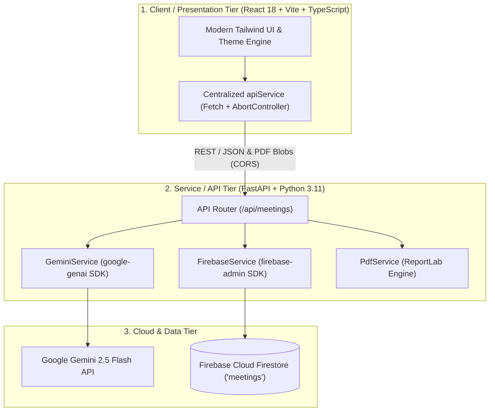

# MeetMind AI — Viva & Technical Evaluation Guide

This guide is designed for undergraduate and graduate Computer Science & Engineering (AI/ML) students defending **MeetMind AI: AI-Powered Meeting-to-Action Assistant** during project evaluations, lab assessments, and technical viva voce examinations.

---

## 1. Executive Summary & 1-Minute Elevator Pitch

> *"Good morning, esteemed examiners. **MeetMind AI** is an intelligent full-stack system engineered to eliminate the gap between spoken meeting dialogues and structured project execution.*
>
> *While traditional speech-to-text or transcription tools merely convert audio into huge walls of text, MeetMind AI processes raw, unstructured meeting transcripts using Google Gemini 2.5 Flash to automatically extract executive summaries, discussion points, explicit decisions, and structured action items with assigned owners and deadlines.*
>
> *Crucially, unlike standard conversational chatbots that hallucinate or silently assign tasks, MeetMind AI features a dedicated **ambiguity detection and clarification feedback loop**. It proactively flags unassigned tasks, vague deadlines, or mere brainstorming suggestions and allows users to resolve them in-place.*
>
> *The system persists meeting records and clarification audit histories in **Firebase Cloud Firestore**, allows users to reopen historical meetings with zero data loss, and compiles executive-ready, multi-page meeting reports via a server-side **ReportLab PDF engine**.*
>
> *The platform is built with React 18, TypeScript, and Tailwind CSS on the frontend, and Python 3.11 with FastAPI on the backend, supported by 38 automated backend tests and 16 frontend unit tests."*

---

## 2. Problem Statement & Key Objectives

### The Problem
In modern software engineering and business operations, teams spend significant hours in syncs, sprint planning, and architectural reviews:
1. **Information Overload**: Teams generate multi-page conversational transcripts where key takeaways are buried.
2. **Ambiguous Ownership**: Action items are spoken without explicit owners (e.g., *"Someone should update the documentation"*).
3. **Vague Deadlines**: Due dates are framed colloquially (e.g., *"Let's try to wrap this up by Friday"*).
4. **Suggestion vs. Decision Conflation**: Brainstorming proposals (e.g., *"We should consider migrating to Rust"*) are frequently miscataloged as binding organizational decisions.
5. **Loss of Session History**: Stateless AI analysis tools force users to re-submit transcripts, losing resolution history.

### The Objectives
- **Accurate Automated Extraction**: Extract clean executive summaries, discussion points, confirmed decisions, and action items.
- **Strict Anti-Hallucination Guardrails**: If an owner or deadline is unmentioned, store it strictly as `null` rather than guessing or hallucinating.
- **Ambiguity Detection & Targeted Clarification**: Detect missing parameters, formulate targeted questions, and re-evaluate only the relevant items upon user feedback.
- **Cloud Persistence & Auditing**: Store historical meetings, structured outputs, and revision logs in Google Cloud Firestore.
- **Professional Artifact Generation**: Compile multi-page, publication-grade executive PDFs for stakeholder distribution.

---

## 3. System Architecture & End-to-End Request Flow

### 3.1 Three-Tier Decoupled Architecture

### 3.2 End-to-End Execution Sequence
1. **Transcript Ingestion**: The user inputs or loads a meeting transcript in the frontend `TranscriptWorkspace`.
2. **AI Analysis (`POST /api/meetings/analyze`)**:
   - Backend validates that the transcript is non-empty.
   - `GeminiService` constructs a prompt with strict few-shot anti-hallucination extraction rules.
   - Gemini API generates a JSON response adhering to `MeetingAnalysisResponse`.
   - `FirebaseService` creates a new document in Firestore with a collision-resistant `meeting_id` (e.g. `m_1730650000_a1b2c3d4`), saving the raw transcript, timestamp, and analysis.
   - Frontend receives the structured result and renders the cards, metrics, and badges.
3. **Ambiguity Resolution (`POST /api/meetings/clarify`)**:
   - The user answers open ambiguity questions (e.g., *"David will handle it by Thursday 10 AM"*).
   - Backend sends the original analysis and new answers to Gemini with strict update instructions.
   - Gemini updates only affected action items, flips `resolved: true`, and re-evaluates `clarification_required`.
   - `FirebaseService` executes an atomic `doc_ref.update()` in Firestore, appending answers to `answers_history` without duplicating the meeting document.
4. **Meeting Reopening (`GET /api/meetings` & `GET /api/meetings/{id}`)**:
   - History panel fetches recent meetings ordered by `updated_at DESC`.
   - Selecting a meeting retrieves the stored record, restoring the transcript, title, decisions, tasks, and clarification state in the UI.
5. **PDF Export (`POST /export/pdf` or `GET /{id}/export/pdf`)**:
   - `PdfService` parses the meeting analysis into ReportLab flowables.
   - A custom two-pass `NumberedCanvas` compiles the document into an in-memory `io.BytesIO` buffer.
   - The PDF binary is streamed to the browser with `Content-Disposition: attachment; filename="meetmind_{slug}.pdf"`.

---

## 4. Technical Justifications (Why This Stack?)

| Technology | Role | Why Chosen? | Key Alternatives Considered & Rejected |
| :--- | :--- | :--- | :--- |
| **React 18 + Vite** | Frontend Framework | Fast HMR development, component reusability, modular state management, and lightweight bundle footprint. | *Create React App* (deprecated, slow builds), *Next.js* (unnecessary SSR overhead for a SPA dashboard). |
| **TypeScript** | Programming Language | Compile-time type safety preventing runtime schema mismatches between API responses and UI state. | *Vanilla JavaScript* (prone to `undefined` errors when traversing nested AI outputs). |
| **Tailwind CSS** | Styling System | Rapid utility-first styling, zero CSS runtime overhead, easy dark/light mode toggle with CSS variables. | *Bootstrap / Material UI* (heavyweight, rigid styling abstractions). |
| **FastAPI** | Backend Framework | High-performance asynchronous execution, native OpenAPI (Swagger) generation, automatic Pydantic validation. | *Flask* (lacks native async, manual schema validation), *Django* (monolithic, excessively heavy for microservices). |
| **Google Gemini 2.5 Flash** | AI Engine | Large context window (1M tokens), high token throughput, cost-efficiency, and strong adherence to structured JSON schemas. | *Gemini 1.5 Pro* (slower latency for interactive syncs), *OpenAI GPT-4o* (higher cost, outside Google Cloud ecosystem). |
| **Firebase Cloud Firestore** | Database | Serverless NoSQL document model matching JSON schemas naturally, zero database administration, official Python SDK. | *MongoDB* (requires cluster hosting/credentials management), *PostgreSQL* (relational schema requires relational table mapping for nested clarifications). |
| **ReportLab** | PDF Generation Engine | Programmatic, high-precision layout control, native page-budgeting canvas (`NumberedCanvas`), in-memory binary streaming. | *Weasyprint / wkhtmltopdf* (requires headless Chromium / system C-library dependencies, difficult to containerize). |

---

## 5. Deep-Dive: Core Mechanisms

### 5.1 The Anti-Hallucination & Ambiguity Architecture
Large Language Models tend to make assumptions when presented with incomplete facts. For instance, if a transcript says *"We should fix the login bug soon"*, generic models often invent a fictitious deadline (e.g., *"Friday"*) or assign it to whoever spoke last.

**MeetMind AI solves this using a two-pronged strategy:**
1. **Explicit Null Constraints**:
   - The system prompt enforces: `"If an action item has no clearly stated owner, set owner to null. Do not guess."`
   - `"If no deadline is stated, set deadline to null."`
2. **Ambiguity Taxonomy**:
   - Ambiguities are systematically tagged into 5 categories:
     - `ownership`: Missing or ambiguous assignee.
     - `deadline`: Colloquial or missing due date.
     - `task_scope`: Unclear deliverable specification.
     - `decision_vs_suggestion`: Brainstorming proposals vs. binding commitments.
     - `missing_context`: Lacking technical prerequisites.

### 5.2 Atomic Firestore Updates vs. Document Duplication
When resolving clarification questions, MeetMind AI does not overwrite the record with a new ID or create version sprawl. Instead:
- Uses `meeting_id` as the Firestore document key.
- Calls `doc_ref.update({"analysis": updated_analysis, "updated_at": utc_now, "answers_history": firestore.ArrayUnion(...)})`.
- Guarantees idempotent, zero-duplicate updates.

### 5.3 PDF Compilation & The `NumberedCanvas` Engine
ReportLab generates flowables in a single pass by default. However, executive reports require `"Page X of Y"` footers and running headers only on pages 2+.
- MeetMind AI implements `NumberedCanvas(canvas.Canvas)`.
- It overrides `showPage()` to stash page states and delays painting until `save()` is invoked, where the exact total page count is known.
- All table cells encapsulate `Paragraph` objects rather than raw strings, ensuring multi-line text wraps gracefully without overflowing page margins.

---

## 6. Top 25 Viva Questions & Model Answers

### Category A: Architecture & Design Decisions

#### Q1: What is the primary problem that MeetMind AI addresses compared to conventional transcription tools?
**Answer:** Conventional transcription tools (like Whisper or Otter.ai) generate raw verbatim speech transcripts. While they capture spoken words, they do not extract structured execution items. Team members must still manually read pages of dialogue to extract what was decided and who is responsible. MeetMind AI bridges this gap by transforming conversational dialogues into verified summaries, explicit decisions, task assignments with owners/deadlines, and actively highlights ambiguities for clarification.

#### Q2: Why did you choose FastAPI over traditional Python frameworks like Flask or Django?
**Answer:** FastAPI offers three decisive advantages for our architecture:
1. **High Performance & Asynchronous Support**: FastAPI is built on Starlette and ASGI (`uvicorn`), offering performance on par with Go or Node.js.
2. **Native Pydantic v2 Integration**: Request payloads and response models are strictly validated at the controller boundary.
3. **Automated Interactive Documentation**: Generates interactive Swagger (`/docs`) and ReDoc (`/redoc`) specifications automatically from code schemas.

#### Q3: Why is React 18 with Vite used for the frontend instead of server-side rendering (SSR) like Next.js?
**Answer:** MeetMind AI is an interactive client workspace where users input transcripts, monitor multi-step loading spinners, answer interactive questions, toggle themes, and stream binary PDFs. A Single Page Application (SPA) powered by Vite provides instantaneous Client-Side Navigation and Sub-second Hot Module Replacement (HMR) without the operational complexity or server costs of SSR.

#### Q4: How does the frontend communicate with the backend?
**Answer:** Communication occurs over HTTP/REST using a centralized `apiService` class written in TypeScript. It wraps the browser `fetch` API, manages `AbortController` timeouts (5s for health, 10s for listing, 60s for AI analysis), classifies network vs. HTTP errors (e.g. 502 upstream vs. 503 unconfigured), and parses binary Blobs for PDF file downloads.

#### Q5: Explain the database selection. Why Cloud Firestore instead of relational databases like PostgreSQL or MySQL?
**Answer:** Meeting intelligence data is semi-structured and hierarchical: an analysis contains an executive summary, arrays of string decisions, arrays of complex `ActionItem` objects, and variable-length clarification threads. A document-oriented NoSQL database like Firebase Cloud Firestore matches this data model directly without requiring complex multi-table relational joins, migrations, or Object-Relational Mappings (ORMs).

---

### Category B: Artificial Intelligence & Prompt Engineering

#### Q6: Which LLM is integrated into MeetMind AI, and why?
**Answer:** We integrate Google's **Gemini 2.5 Flash** using the official `google-genai` Python SDK. We chose Flash because meeting transcript extraction requires high throughput, sub-second latency, and a massive context window (up to 1 million tokens), allowing the analysis of multi-hour meetings at negligible cost compared to larger reasoning models.

#### Q7: How do you prevent Gemini from hallucinating task owners and deadlines?
**Answer:** We employ prompt-level guardrails and strict negative constraints:
1. The system prompt explicitly commands the model: *"If an action item has no clearly stated owner, set owner to null. Do NOT assume, infer, or guess owners from speakers."*
2. Similarly, for deadlines: *"Set deadline to null if no specific timeframe or due date is mentioned."*
3. The Pydantic model defines `owner: Optional[str] = None` and `deadline: Optional[str] = None`. This ensures that missing attributes are represented as clean `null` primitives rather than placeholder strings.

#### Q8: What is the Ambiguity Detection engine and how does it categorize ambiguities?
**Answer:** MeetMind AI scans transcript statements for implicit or incomplete execution details across five distinct taxonomies:
1. `ownership`: Task stated without an assigned owner (e.g., *"Someone must deploy this"*).
2. `deadline`: Vague temporal terms (e.g., *"Let's finish this soon"*).
3. `task_scope`: Unclear deliverables (e.g., *"Alex will take care of it"*).
4. `decision_vs_suggestion`: Preliminary brainstorming ideas (e.g., *"We should consider shifting to AWS"*) which must not be cataloged as binding decisions.
5. `missing_context`: Prerequisite questions requiring external input.

#### Q9: What happens when a user submits an ambiguous or unhelpful answer during clarification?
**Answer:** When the user submits an answer like *"We still haven't decided"* or *"Not sure"*, Gemini re-evaluates the answer against the original ambiguity. If the answer does not provide concrete resolution, Gemini preserves `resolved: false` on that clarification item, and `clarification_required` remains `true`. The ambiguity is not cleared until definitive details are provided.

#### Q10: How does the backend prevent data loss if Gemini accidentally omits unrelated action items during a clarification re-evaluation?
**Answer:** In `GeminiService.resolve_clarifications()`, we implement a **non-destructive merge guardrail**. If Gemini returns a re-evaluated analysis that inadvertently drops action items or decisions that were not part of the active clarification, our backend post-processor detects the omission by ID comparison and automatically merges the existing items back into the response.

---

### Category C: Persistence, Storage & Firebase

#### Q11: How is Firebase initialized in the FastAPI backend?
**Answer:** Initialization is encapsulated within a singleton [`FirebaseService`](file:///Users/vishalkumar/Library/CloudStorage/GoogleDrive-rohitmpk200416@gmail.com/My Drive/AgenticAI P1/backend/app/services/firebase_service.py). During FastAPI's startup lifespan context, `firebase_service.initialize_app()` checks if credentials are configured. It safely checks `firebase_admin._apps` to prevent `ValueError: The default Firebase app already exists` and instantiates the `firestore.client()`.

#### Q12: How are credentials managed securely for Firebase?
**Answer:** Credentials are never hardcoded. MeetMind AI supports:
1. A path to the service account key JSON file via `FIREBASE_CREDENTIALS_PATH`.
2. A raw JSON string in environment variable `FIREBASE_CREDENTIALS_JSON`.
3. Google Application Default Credentials (ADC).
All service account key files (`*serviceAccountKey*.json`, `*firebase*.json`) are excluded in `.gitignore`.

#### Q13: What is the schema of a meeting document in Cloud Firestore?
**Answer:** Each document in the `meetings` collection contains:
- `meeting_id`: String primary key (`m_<timestamp>_<uuid>`).
- `title`: Optional user-specified title.
- `transcript`: The raw conversational text.
- `created_at` & `updated_at`: ISO 8601 UTC timestamps.
- `analysis`: Complete `MeetingAnalysisResponse` JSON (summary, discussion points, decisions, action items, clarifications).
- `answers_history`: Array of historical resolution entries (`clarification_id`, `answer`, `timestamp`).

#### Q14: How does MeetMind AI ensure that updating a meeting does not create duplicate documents?
**Answer:** The frontend tracks the current `meeting_id`. When `/api/meetings/clarify` is called, `meeting_id` is passed in the request body. The backend performs an in-place atomic update:
`doc_ref.update({"analysis": updated_analysis.model_dump(), "updated_at": now, "answers_history": firestore.ArrayUnion(...)})`.
This updates the document without altering its ID or creating extra rows.

#### Q15: What happens if Firestore is not configured when a user clicks the History tab?
**Answer:** The system degrades gracefully. The route `/api/meetings` checks `firebase_service.is_configured()`. If unconfigured, it returns `503 Service Unavailable` with a descriptive error message. The frontend catches this and renders an informative `"Persistence unavailable"` badge without crashing the UI or blocking transcript analysis.

---

### Category D: PDF Generation & Export Architecture

#### Q16: Why was ReportLab chosen over HTML-to-PDF converters like Puppeteer or Weasyprint?
**Answer:** HTML-to-PDF converters require heavy system dependencies: Weasyprint depends on Cairo and Pango C-libraries, while Puppeteer requires downloading a ~300MB headless Chromium binary. ReportLab is a pure-Python library with zero native system binary requirements, making it lightweight, fast, portable, and ideal for containerized microservices.

#### Q17: How does the PDF generator handle multi-page overflow?
**Answer:** 
1. **Flowable Splitting**: The document uses `SimpleDocTemplate` with ReportLab flowables (`Paragraph`, `Table`, `Spacer`, `HRFlowable`).
2. **Table Text Wrapping**: Table cells contain `Paragraph` flowables rather than plain strings, enabling auto-wrapping.
3. **Multi-Row Transcript Flow**: Transcripts are partitioned into sequential single-line table rows or paragraphs so ReportLab can split them across page boundaries naturally without throwing `LayoutError`.

#### Q18: What is a `NumberedCanvas` and why was it necessary?
**Answer:** In standard single-pass PDF generation, the canvas cannot know the total number of pages while painting page 1. MeetMind AI implements a custom two-pass `NumberedCanvas` class that intercepts `showPage()` to record the canvas state and only writes headers/footers during `save()`. This allows rendering accurate `"Page 1 of 5"`, `"Page 2 of 5"` pagination and running headers on pages > 1.

#### Q19: How are PDF filenames generated and sanitized?
**Answer:** In [`PdfService.sanitize_filename()`](file:///Users/vishalkumar/Library/CloudStorage/GoogleDrive-rohitmpk200416@gmail.com/My Drive/AgenticAI P1/backend/app/services/pdf_service.py), arbitrary meeting titles (e.g., *"Sprint Sync: Mobile App / Q3 & Blockers!"*) are sanitized using regular expressions to strip non-alphanumeric characters, convert spaces to underscores, and truncate the slug to 45 characters (e.g. `meetmind_sprint_sync_mobile_app_q3_blockers.pdf`). This prevents header injection attacks and invalid filesystem filenames.

#### Q20: Where are generated PDF files stored?
**Answer:** PDFs are generated strictly **in-memory** using Python's `io.BytesIO` buffer and streamed directly to the HTTP response with `Content-Type: application/pdf`. They are not stored on local disk or in cloud storage, preserving user privacy, eliminating disk space leaks, and preventing server storage bloat.

---

### Category E: Testing, QA & Software Engineering Principles

#### Q21: What is the testing strategy for the project?
**Answer:** We follow a test-driven, pyramid-based testing strategy:
- **Backend (Pytest)**: 38 automated tests covering route validations, schema invariants, health endpoints, CORS, mocked Gemini extraction, ambiguity detection, clarification merging, Firestore persistence, and PDF compiling.
- **Frontend (Node Test Runner)**: 16 automated tests covering API client methods, 404 fallbacks, timeout aborts, error banner state, and binary blob generation.
- **Mocking Philosophy**: Automated tests use mocked Gemini and Firestore clients (`MockFirestoreClient`), allowing the entire test suite to pass in < 1 second **without requiring live cloud credentials or internet connectivity**.

#### Q22: How do you test the Gemini AI integration without spending API credits in automated CI/CD?
**Answer:** In [`backend/tests/test_meetings.py`](file:///Users/vishalkumar/Library/CloudStorage/GoogleDrive-rohitmpk200416@gmail.com/My Drive/AgenticAI P1/backend/tests/test_meetings.py), we mock the Google GenAI SDK's `models.generate_content()` method using Python's `unittest.mock.MagicMock`. The mock returns pre-constructed JSON responses simulating both successful extractions and API failures. For manual smoke testing with real credits, a separate dedicated script [`backend/scripts/live_e2e_test.py`](file:///Users/vishalkumar/Library/CloudStorage/GoogleDrive-rohitmpk200416@gmail.com/My Drive/AgenticAI P1/backend/scripts/live_e2e_test.py) is provided.

#### Q23: How is CORS (Cross-Origin Resource Sharing) configured, and why is it important?
**Answer:** The frontend runs on `http://localhost:5173` while the backend runs on `http://localhost:8000`. By browser security policies, cross-origin requests are blocked unless allowed by the server. In [`backend/app/main.py`](file:///Users/vishalkumar/Library/CloudStorage/GoogleDrive-rohitmpk200416@gmail.com/My Drive/AgenticAI P1/backend/app/main.py), we register FastAPI's `CORSMiddleware`, allowing specific client origins configured in `settings.CORS_ORIGINS`.

#### Q24: What are the current limitations of MeetMind AI?
**Answer:**
1. **Plaintext Transcripts Only**: Currently expects text transcripts; direct live audio recording or speech-to-text transcription is not yet integrated.
2. **Single-Tenant Authentication**: Firestore collections are stored at project level; multi-user authentication (e.g. Firebase Auth) with per-user tenant isolation is reserved for future milestones.
3. **Core PDF Fonts**: Uses standard PDF Type 1 fonts (`Helvetica`, `Courier`) for universal cross-platform compatibility rather than custom TrueType web fonts.

#### Q25: What future improvements would you propose for Phase 9 and beyond?
**Answer:**
1. **Real-Time Audio Ingestion**: Integration with Gemini Live API or Whisper for real-time streaming meeting transcription.
2. **Direct Task Tool Integrations**: Webhook sync to push extracted action items directly into Jira, Linear, Asana, or GitHub Issues.
3. **User Authentication & Role-Based Access Control**: Adding Firebase Auth / OAuth2 for team-based workspaces and private meeting archives.
4. **Speaker Diarization & Calendar Sync**: Associating recognized speakers with Google Calendar attendee profiles for automated follow-up emails.

---

## 7. Manual Live Demonstration Walkthrough Checklist

During your evaluation or lab demonstration, follow this step-by-step workflow:

1. **Verify Backend Status**:
   - Point out the real-time heartbeat connection pill in the top header (`Online (200 OK)`).
   - Show `/docs` Swagger UI in a browser tab to demonstrate the OpenAPI contract.
2. **Load Sample Transcript**:
   - In the Workspace, click the `"Load Sample Transcript"` preset.
   - Point out the character and word counters.
   - Give the meeting a title: *"Sprint Planning & Security Review"*.
3. **Execute AI Analysis**:
   - Click `"Analyze Transcript"`.
   - Observe the multi-step animated loading state (`Parsing dialogue`, `Extracting deliverables`, `Validating ambiguities`).
4. **Inspect Generated Intelligence**:
   - Review the Executive Summary, Key Discussion Topics, and Confirmed Decisions.
   - Highlight Action Items: show that tasks with clear assignees have owner badges (e.g. `Alex`), while vague tasks show `Unassigned` in amber without hallucinated names.
5. **Demonstrate Ambiguity Clarification**:
   - Scroll to the Ambiguity section. Point out the category badge (e.g. `OWNERSHIP`).
   - Type a concrete resolution: *"David from Infrastructure will provision staging access by tomorrow 10 AM"*.
   - Click `"Submit Clarification"`.
   - Show that the target action item updates with `David` and `Tomorrow 10 AM`, while the ambiguity flips to `RESOLVED` with a green checkmark.
6. **Verify Firestore Persistence & History**:
   - Click the `"History"` navigation tab in the sidebar.
   - Show the newly persisted meeting card in the history grid with its timestamp and task count.
   - Open Firebase Console in a browser tab to verify the live document in the `meetings` collection.
7. **Export Executive PDF Report**:
   - Click the `"Export PDF"` button in the results header.
   - Open the downloaded PDF in Acrobat / Preview:
     - Show the MeetMind AI executive branding and metadata grid.
     - Show the action items table with alternate row shading and badges.
     - Show the clarification audit log.
     - Show `"Page 1 of X"` running footers and running headers.
