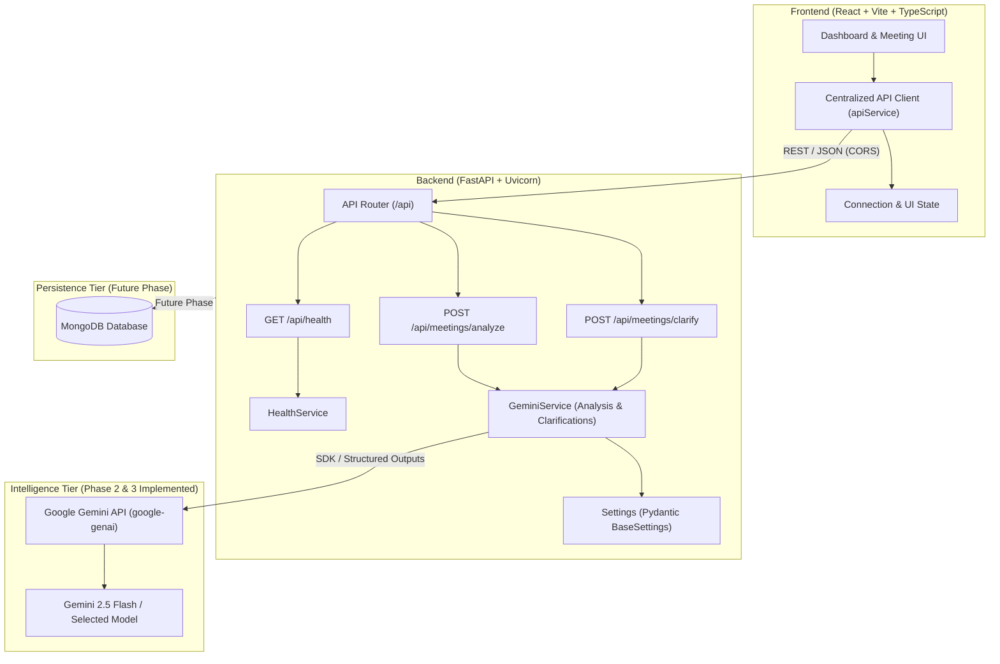
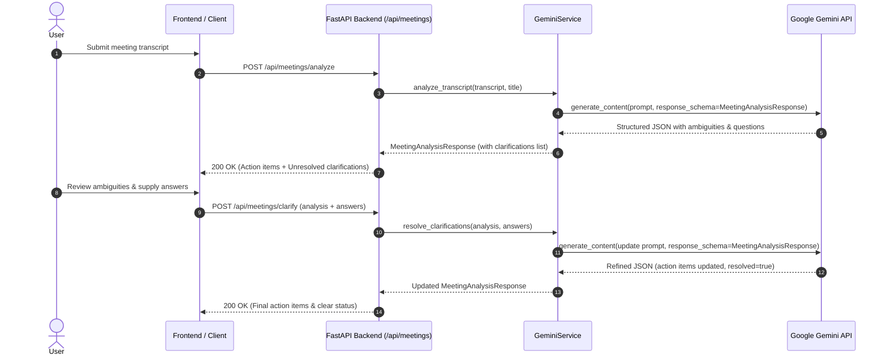

# MeetMind AI — System Architecture & Design Documentation

## 1. System Overview

**MeetMind AI** is an AI-powered meeting-to-action platform built to ingest raw, unstructured meeting transcripts and synthesize them into actionable insights, structured decisions, assigned deliverables, and clarifying questions.

The system is designed with a decoupled client-server architecture:
- **Client Tier**: React 18, Vite, TypeScript, Tailwind CSS, Lucide React icons (Modern productivity workspace with dark/light themes, loading states, and clarification feedback loops).
- **Service Tier**: Python 3.11+, FastAPI, Uvicorn, Pydantic v2.
- **Intelligence Tier**: Google Gemini API via official SDK (`google-genai` v2.34+).
- **Data Tier (Phase 6)**: MongoDB for persistent meeting records and action items.
- **Export Tier (Phase 7)**: PDF / Markdown summary generators.

---

## 2. Architecture Diagram

---

## 3. Communication Protocols

| Route | Method | Purpose | Implementation Phase |
| :--- | :--- | :--- | :--- |
| `/api/health` | `GET` | System heartbeat & availability check | **Phase 1 (Implemented)** |
| `/api/meetings/analyze` | `POST` | Transcript parsing & ambiguity detection | **Phase 2 & 3 (Implemented)** |
| `/api/meetings/clarify` | `POST` | Re-evaluation with user clarification answers | **Phase 3 & 4 (Implemented)** |
| `/api/meetings` | `GET/POST` | Meeting storage & historical retrieval | Planned (Phase 6) |
| `/api/actions` | `GET/PATCH` | Action item tracking & status updates | Planned (Phase 6) |

---

## 4. Ambiguity Detection & Clarification Workflow (Phase 3 & 4)

### 4.1 Sequence Flow

### 4.2 Ambiguity Taxonomies
1. **Ownership (`ownership`)**: Statements lacking an assigned owner (e.g., *"Someone should send the report"*). Action item owner remains `null` until confirmed.
2. **Deadline (`deadline`)**: Statements with vague or ambiguous dates (e.g., *"Finish this by Friday"*). Deadline remains `null` until clarified.
3. **Task Scope (`task_scope`)**: Statements where the deliverable or responsibility is ambiguous (e.g., *"Alex will handle it"*).
4. **Decision vs. Suggestion (`decision_vs_suggestion`)**: Brainstorming proposals or ideas (e.g., *"We should consider launching next month"*) are strictly excluded from confirmed `decisions` unless validated.
5. **Missing Context (`missing_context`)**: Statements that lack necessary prerequisites or contextual background.

### 4.3 Safe Non-Destructive Updates
- Unanswered or unrelated action items and decisions are untouched.
- When an answer is vague or uncertain (e.g., *"Still undecided"*), the ambiguity is preserved with `resolved: false`.
- Only when all clarifications have `resolved: true` does `clarification_required` flip to `false` and `clarification_question` reset to `null`.

---

## 5. Frontend UI Architecture & State Management (Phase 4)

### 5.1 Component Hierarchy
- `App.tsx`: Global layout, theme state (persisted to `localStorage`), document class sync, and API heartbeat polling.
  - `Sidebar.tsx`: Navigation items, active phase tag, backend connection status, and theme toggle switch.
  - `Header.tsx`: Breadcrumb navigation, live backend status pill, and "New Meeting" reset action.
  - `Dashboard.tsx`: Primary view coordinating workspace input, loading states, and analysis displays.
    - `TranscriptWorkspace.tsx`: Multi-line transcript input, title field, live word/character counters, sample transcript loader, and validation.
    - `AnalysisLoadingState.tsx`: Animated multi-step progress indicators for analysis and clarification re-evaluation.
    - `AnalysisResults.tsx`: Executive summary, discussion points, confirmed decisions, action items, and embedded clarifications.
      - `ClarificationSection.tsx`: Ambiguity feedback loop with category badges, input fields, resolve triggers, and error banners.
    - `EmptyState.tsx`: Clean contextual guidance before analysis.
    - `StatsCard.tsx`: Metric indicators (discussion points, decisions, actions, ambiguities).

### 5.2 Clarification State & Failure Resilience
1. **In-Place Updates**: User answers are batched and dispatched to `POST /api/meetings/clarify` alongside the current analysis snapshot.
2. **Failure Preservation**: If clarification submission fails (e.g., network drop or Gemini 502/503), existing results remain visible and user input is preserved alongside an inline error alert.
3. **Optimistic & Resolved Styling**: Resolved clarifications are styled in muted green tones with checkmark indicators, while pending items remain highlighted in amber.

---

## 6. Security & Configuration Best Practices

1. **Environment Segregation**: Secrets and environment-specific parameters are managed via `.env` files; `.env.example` templates define required schema without exposing credentials.
2. **CORS Governance**: FastAPI `CORSMiddleware` restricts browser origins to approved client ports (`localhost:5173`, `localhost:3000`).
3. **No Frontend Secrets**: The frontend only communicates with the backend API. All Gemini API keys and database connection strings are confined strictly to the backend environment.
4. **Graceful Error Sanitization**: API keys are never included in log outputs, error messages, or exception traces. Upstream Gemini API errors map to standard HTTP status codes (`502 Bad Gateway`, `503 Service Unavailable`).
