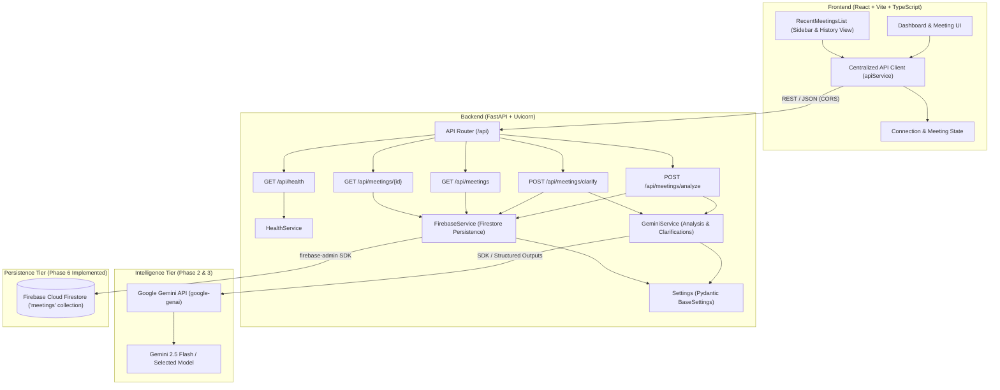
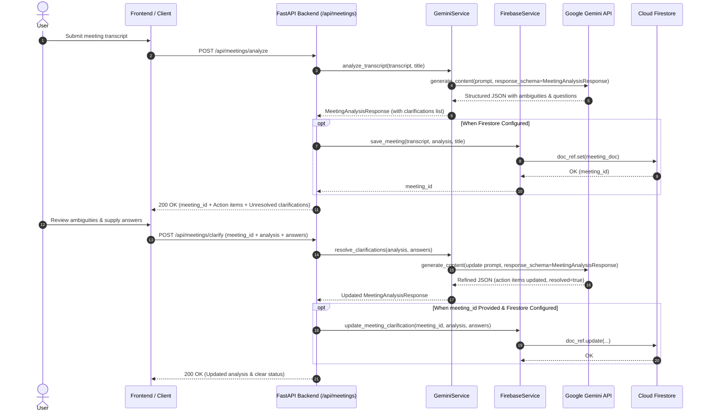

# MeetMind AI — System Architecture & Design Documentation

## 1. System Overview

**MeetMind AI** is an AI-powered meeting-to-action platform built to ingest raw, unstructured meeting transcripts and synthesize them into actionable insights, structured decisions, assigned deliverables, and clarifying questions.

The system is designed with a decoupled client-server architecture:
- **Client Tier**: React 18, Vite, TypeScript, Tailwind CSS, Lucide React icons (Modern productivity workspace with dark/light themes, loading states, recent meetings history panel, and clarification feedback loops).
- **Service Tier**: Python 3.11+, FastAPI, Uvicorn, Pydantic v2.
- **Intelligence Tier**: Google Gemini API via official SDK (`google-genai` v2.34+).
- **Persistence Tier (Phase 6 Implemented)**: Firebase Cloud Firestore via official `firebase-admin` Python SDK for persistent meeting records, transcripts, analyses, and clarification history.
- **Export Tier (Phase 7 Planned)**: PDF / Markdown summary generators.

---

## 2. Architecture Diagram



---

## 3. Communication Protocols & API Matrix

| Route | Method | Purpose | Implementation Phase |
| :--- | :--- | :--- | :--- |
| `/health` | `GET` | Root health check & availability probe | **Phase 5 (Implemented)** |
| `/api/health` | `GET` | API health check & application metadata | **Phase 1 & 5 (Implemented)** |
| `/api/meetings/analyze` | `POST` | Transcript parsing, ambiguity detection, & Firestore persistence | **Phase 2, 3, 5, 6 (Implemented)** |
| `/api/meetings/clarify` | `POST` | Re-evaluation with clarification answers & in-place Firestore update | **Phase 3, 4, 5, 6 (Implemented)** |
| `/api/meetings` | `GET` | Retrieve list of recent saved meetings from Firestore (with `limit` param) | **Phase 6 (Implemented)** |
| `/api/meetings/{id}` | `GET` | Retrieve full meeting transcript, analysis, and answers history | **Phase 6 (Implemented)** |
| `/api/actions` | `GET/PATCH` | Action item tracking & status updates | Planned (Phase 7) |

---

## 4. Ambiguity Detection & Clarification Workflow (Phase 3 & 4)

### 4.1 Sequence Flow



### 4.2 Ambiguity Taxonomies
1. **Ownership (`ownership`)**: Statements lacking an assigned owner (e.g., *"Someone should send the report"*). Action item owner remains `null` until confirmed.
2. **Deadline (`deadline`)**: Statements with vague or ambiguous dates (e.g., *"Finish this by Friday"*). Deadline remains `null` until clarified.
3. **Task Scope (`task_scope`)**: Statements where the deliverable or responsibility is ambiguous (e.g., *"Alex will handle it"*).
4. **Decision vs. Suggestion (`decision_vs_suggestion`)**: Brainstorming proposals or ideas (e.g., *"We should consider launching next month"*) are strictly excluded from confirmed `decisions` unless validated.
5. **Missing Context (`missing_context`)**: Statements that lack necessary prerequisites or contextual background.

### 4.3 Safe Non-Destructive Updates & Drop Prevention
- **Automatic Merge Safeguard**: If an LLM response during clarification omits unrelated action items, decisions, or discussion points from the original analysis, the backend post-processor automatically detects the omission and preserves the original items.
- **Clarification Preservation**: Any unaddressed clarification from the original analysis is retained in its `resolved: false` state if omitted by the model.
- **Ambiguity Continuity**: When an answer is vague or uncertain (e.g., *"Still undecided"*), the ambiguity is preserved with `resolved: false`.
- **Status Coherence**: Only when all clarifications have `resolved: true` does `clarification_required` flip to `false` and `clarification_question` reset to `null`.
- **Batch Processing**: The endpoint supports multiple clarification answers in a single request, allowing the client to resolve multiple ambiguities simultaneously.

---

## 5. Persistence Tier Architecture: Firebase Cloud Firestore (Phase 6)

### 5.1 Technology Choice & Rationale
Cloud Firestore was selected to replace MongoDB for MeetMind AI persistence:
- **Serverless & Scalable**: Native document database with zero database administration overhead.
- **Document Flexibility**: Cleanly stores nested meeting analyses, action item collections, and clarification audit histories.
- **Python Admin SDK**: First-class integration via `firebase-admin>=6.5.0` with secure service account credentials or Application Default Credentials (ADC).
- **Developer Experience**: Intuitive Firebase Console to view, query, and inspect persisted collections.

### 5.2 Firestore Document Data Schema

Each document in the `meetings` collection follows this schema:

```json
{
  "meeting_id": "meet_a1b2c3d4e5f6",
  "title": "Mobile App Redesign Sync",
  "transcript": "Sarah: Let us review the blockers...",
  "created_at": "2026-11-03T18:00:00.000Z",
  "updated_at": "2026-11-03T18:15:30.000Z",
  "analysis": {
    "summary": "The team aligned on the mobile app redesign milestones...",
    "discussion_points": [
      "Figma design system token handoff from David",
      "GraphQL schema updates for user preferences"
    ],
    "decisions": [
      "Alex will finalize GraphQL endpoints by Wednesday at 4 PM"
    ],
    "action_items": [
      {
        "id": "action_1",
        "task": "Confirm and finalize GraphQL schema changes",
        "owner": "Alex",
        "deadline": "Wednesday 4 PM",
        "status": "pending"
      }
    ],
    "clarification_required": false,
    "clarification_question": null,
    "clarifications": [
      {
        "id": "clarif_1",
        "category": "ownership",
        "original_statement": "Someone should provision them by tomorrow morning.",
        "explanation": "No specific individual or team was assigned.",
        "question": "Who is specifically responsible for provisioning credentials?",
        "related_action_item_id": "action_2",
        "resolved": true
      }
    ],
    "meeting_id": "meet_a1b2c3d4e5f6"
  },
  "answers_history": [
    {
      "clarification_id": "clarif_1",
      "answer": "David from DevOps will provision the credentials by tomorrow 10 AM.",
      "timestamp": "2026-11-03T18:15:30.000Z"
    }
  ]
}
```

### 5.3 In-Place Update Lifecycle
1. **Initial Analysis**: `POST /api/meetings/analyze` parses the transcript and calls `FirebaseService.save_meeting()`, generating a unique `meeting_id` (`meet_<hex>`) and setting initial `created_at` and `updated_at` timestamps.
2. **Clarification Update**: When the user answers clarifications, the client passes `meeting_id` to `POST /api/meetings/clarify`. `FirebaseService.update_meeting_clarification()` executes an in-place update using Firestore's atomic `doc_ref.update(...)`:
   - Updates `analysis` with the resolved items and status.
   - Sets `updated_at` to the current UTC timestamp.
   - Appends submitted answers to `answers_history`.
   - **Zero Duplication**: No duplicate documents are created.
3. **Restoring Previous Meetings**: When clicking any meeting from the Sidebar or History view, `GET /api/meetings/{meeting_id}` retrieves the complete stored document. The frontend restores the original transcript, title, structured results, and active clarification status.

---

## 6. Frontend UI Architecture & State Management (Phase 4 & 6)

### 6.1 Component Hierarchy
- `App.tsx`: Central state hub managing active meeting, recent meetings list, theme preference (`localStorage`), health heartbeat polling, and data fetching.
  - `Sidebar.tsx`: Navigation items (`Workspace`, `History`), active phase badge ("Phase 6"), compact recent meetings list, and theme switcher.
  - `Header.tsx`: Breadcrumb navigation, live backend status pill, and "New Meeting" reset button.
  - `Dashboard.tsx`: Primary view coordinating workspace input, recent meetings history view, loading states, and analysis displays.
    - `RecentMeetingsList.tsx`: Reusable meeting history component with compact mode (for sidebar) and card grid mode (for dashboard).
    - `TranscriptWorkspace.tsx`: Multi-line transcript input, title field, live word/character counters, sample transcript loader, and validation.
    - `AnalysisLoadingState.tsx`: Animated multi-step progress indicators for analysis and clarification re-evaluation.
    - `AnalysisResults.tsx`: Executive summary, meeting ID badge, collapsible transcript view, discussion points, confirmed decisions, action items, and embedded clarifications.
      - `ClarificationSection.tsx`: Ambiguity feedback loop with category badges, input fields, resolve triggers, and error banners.
    - `StatsCard.tsx`: Metric indicators (discussion points, decisions, actions, ambiguities).

---

## 7. Security & Configuration Best Practices

1. **Environment Segregation**: Secrets and environment-specific parameters are managed via `.env` files; `.env.example` templates define required schema without exposing credentials.
2. **Firebase Credential Security**:
   - Service account keys (`*serviceAccountKey*.json`, `*firebase*.json`, `service-account*.json`) are explicitly excluded in `.gitignore`.
   - Supports file path reference (`FIREBASE_CREDENTIALS_PATH`), raw JSON string (`FIREBASE_CREDENTIALS_JSON`), or GCP Application Default Credentials (ADC).
   - Backend gracefully returns `503 Service Unavailable` if Firestore is requested while unconfigured, preventing crashes or data leakage.
3. **CORS Governance**: FastAPI `CORSMiddleware` restricts browser origins to approved client ports (`localhost:5173`, `localhost:3000`).
4. **No Frontend Secrets**: The frontend only communicates with the backend API. All Gemini API keys and Firebase credentials remain strictly within the backend service tier.
5. **Safe Mocking in Automated Tests**: All unit and integration test suites run with a fully mocked Firestore client (`MockFirestoreClient`), requiring zero live cloud credentials to achieve 100% test pass rates in CI/CD environments.
