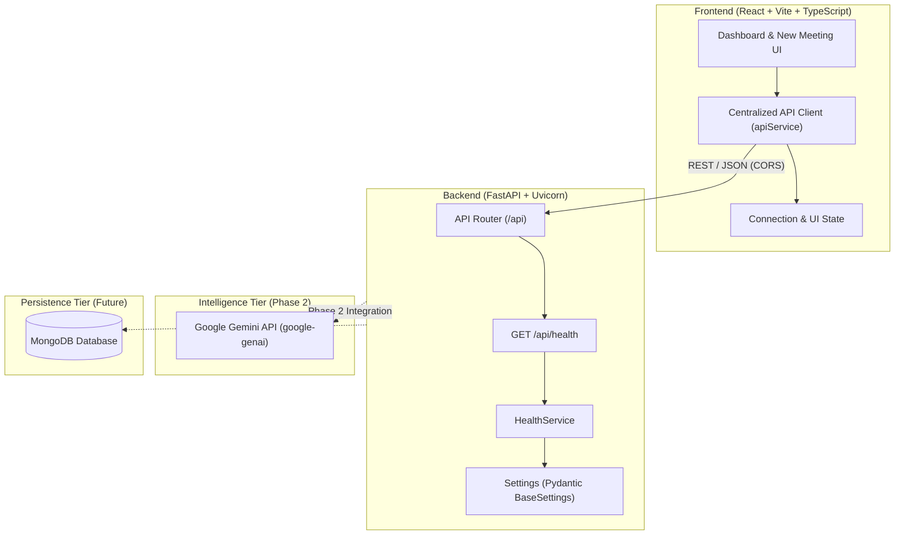

# MeetMind AI — System Architecture & Design Documentation

## 1. System Overview

**MeetMind AI** is an AI-powered meeting-to-action platform built to ingest raw, unstructured meeting transcripts and synthesize them into actionable insights, structured decisions, assigned deliverables, and clarifying questions.

The system is designed with a decoupled client-server architecture:
- **Client Tier**: React 18, Vite, TypeScript, Tailwind CSS, Lucide React icons.
- **Service Tier**: Python 3.11+, FastAPI, Uvicorn, Pydantic v2.
- **Intelligence Tier (Phase 2)**: Google Gemini API via official SDK (`google-genai`).
- **Data Tier (Future Phase)**: MongoDB for persistent meeting records and action items.

---

## 2. Architecture Diagram

---

## 3. Communication Protocols

| Route | Method | Purpose | Implementation Phase |
| :--- | :--- | :--- | :--- |
| `/api/health` | `GET` | System heartbeat & availability check | **Phase 1 (Implemented)** |
| `/api/meetings/analyze` | `POST` | Transcript parsing & Gemini AI pipeline | Planned (Phase 2) |
| `/api/meetings` | `GET/POST` | Meeting storage & historical retrieval | Planned (Phase 3) |
| `/api/actions` | `GET/PATCH` | Action item tracking & status updates | Planned (Phase 3) |

---

## 4. Security & Configuration Best Practices

1. **Environment Segregation**: Secrets and environment-specific parameters are managed via `.env` files; `.env.example` templates define required schema without exposing credentials.
2. **CORS Governance**: FastAPI `CORSMiddleware` restricts browser origins to approved client ports (`localhost:5173`, `localhost:3000`).
3. **No Frontend Secrets**: The frontend only communicates with the backend API. All Gemini API keys and database connection strings are confined strictly to the backend environment.
