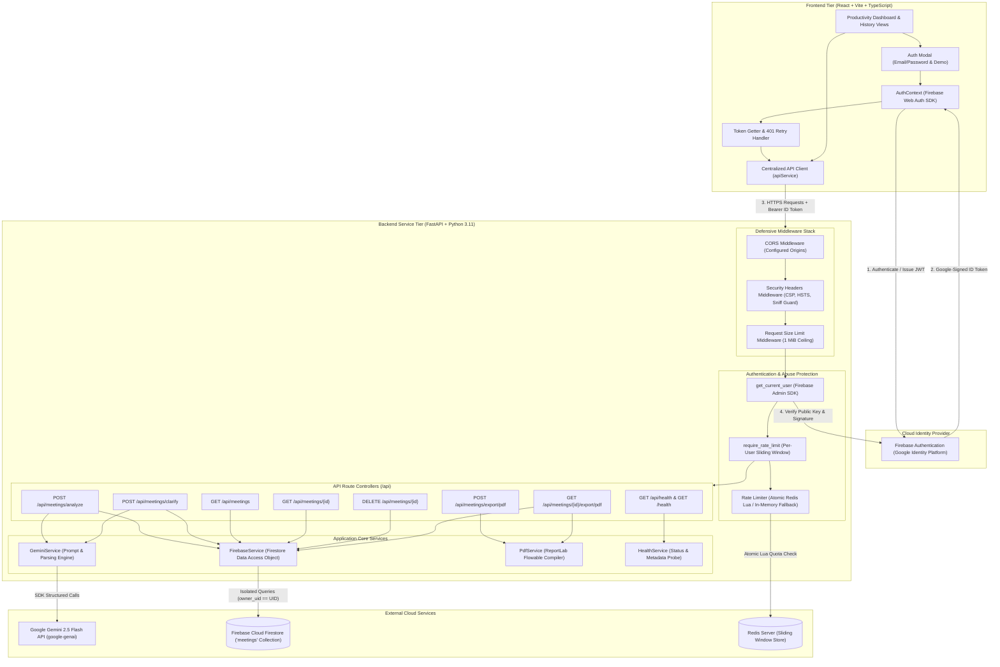
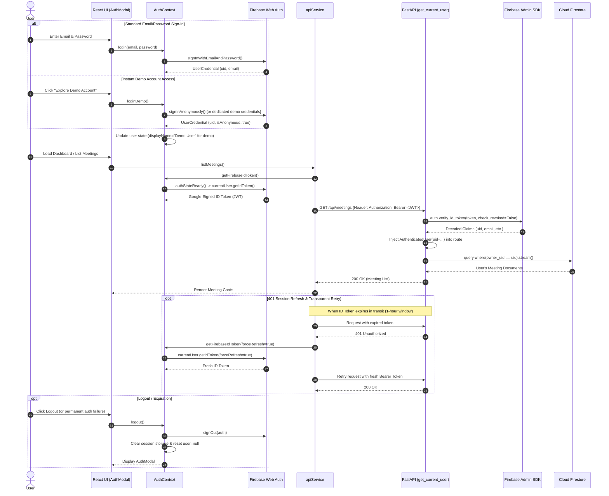

# MeetMind AI — System Architecture & Technical Specification

## 1. System Overview

**MeetMind AI** is an enterprise-grade meeting-to-action assistant that ingests conversational meeting transcripts and synthesizes them into actionable summaries, verified decisions, task deliverables with explicit owners and deadlines, and targeted clarifying questions.

The system is built on a modern, decoupled, multi-tier architecture:
- **Presentation Tier**: React 18, Vite, TypeScript, Tailwind CSS, Framer Motion, and Lucide React icons. Features an accessible productivity dashboard with light/dark themes, interactive ambiguity feedback loops, meeting history management with deletion, PDF report downloads, and integrated Firebase Authentication with instant demo account access.
- **Application & Service Tier**: Python 3.11+, FastAPI (ASGI via Uvicorn), and Pydantic v2. Implements modular route controllers, dependency injection, strict schema validation, defensive security headers, request body size bounding, and per-user sliding-window rate limiting.
- **Security & Identity Tier**: Client-side Firebase Authentication (supporting Email/Password and Anonymous Demo sign-in), secure Bearer JWT transmission, and server-side cryptographic verification via the official `firebase-admin` SDK. Enforces multi-user data isolation via `owner_uid` document binding.
- **Rate Limiting & Abuse Protection**: Tiered sliding-window rate limiter powered by an atomic Redis Lua script (with thread-safe in-memory fallback for local development). Enforces per-user quotas keyed strictly by verified Firebase UID.
- **Intelligence Tier**: Google Gemini API via the official `google-genai` Python SDK (`gemini-2.5-flash`), with prompt-level anti-hallucination guardrails, 4-way ambiguity classification, and non-destructive merge safeguards.
- **Persistence Tier**: Firebase Cloud Firestore via the Python `firebase-admin` SDK. Provides isolated document CRUD, historical clarification audit trails, and zero-duplicate atomic in-place updates.
- **Export Tier**: Server-side PDF report compilation engine powered by Python's `reportlab` library with in-memory binary streaming, custom two-pass `NumberedCanvas`, and auto-wrapping tables.

---

## 2. End-to-End System Architecture



---

## 3. Authentication & Session Lifecycle

MeetMind AI uses an enterprise token-based authentication model combining client-side Firebase Web SDK with backend cryptographic verification.



### 3.1 Authentication Features & Guarantees
1. **Zero Client Trust**: The backend never accepts client-provided user IDs. The caller's `uid` is extracted strictly from cryptographically verified tokens.
2. **Session Persistence**: Firebase handles session caching in IndexedDB. `getFirebaseIdToken()` awaits `auth.authStateReady()` before token resolution, preventing false unauthenticated states during browser reloads.
3. **Transparent 401 Retry**: `apiService.fetchWithAuth()` catches `401 Unauthorized` responses and attempts a single token refresh with `forceRefresh=true`. If the refreshed token succeeds, the request completes seamlessly without interrupting user workflow.
4. **Instant Demo Access**: The "Explore Demo Account" button authenticates via `signInAnonymously(auth)` (or dedicated environment credentials), issuing a genuine Firebase token. This ensures demo sessions are fully verified by the backend without opening security backdoors.
5. **Session Expiration Safety**: If a session cannot be refreshed, the client triggers `onUnauthorized()`, cleans up local session storage, revokes state, and displays an actionable login modal.

---

## 4. Multi-User Ownership & Data Isolation

### 4.1 Firestore Document Schema

Meeting documents in the `meetings` collection follow this schema:

```json
{
  "meeting_id": "m_1730650000_a1b2c3d4",
  "owner_uid": "firebase_user_uid_12345",
  "title": "Quarterly Product Strategy",
  "transcript": "Sarah: Let's review the roadmap blockers...",
  "created_at": "2026-11-04T10:00:00.000Z",
  "updated_at": "2026-11-04T10:15:30.000Z",
  "analysis": {
    "summary": "The team aligned on the product strategy roadmap...",
    "discussion_points": [
      "Frontend performance benchmarks",
      "Authentication migration timeline"
    ],
    "decisions": [
      "Alex will finalize API schema by Wednesday 4 PM"
    ],
    "action_items": [
      {
        "id": "action_1",
        "task": "Finalize API schema updates",
        "owner": "Alex",
        "deadline": "Wednesday 4 PM",
        "status": "pending"
      }
    ],
    "clarification_required": false,
    "clarification_question": null,
    "clarifications": [],
    "open_follow_ups": [],
    "meeting_id": "m_1730650000_a1b2c3d4"
  },
  "answers_history": [
    {
      "clarification_id": "clarif_1",
      "answer": "David will provision staging credentials by tomorrow 10 AM.",
      "timestamp": "2026-11-04T10:15:30.000Z"
    }
  ]
}
```

### 4.2 Ownership Enforcement Rules
- **Creation (`POST /api/meetings/analyze`)**: The meeting document is persisted with `owner_uid: current_user.uid`.
- **Listing (`GET /api/meetings`)**: Queries Firestore strictly filtered by `FieldFilter("owner_uid", "==", current_user.uid)`. Results are sorted in memory by `updated_at DESC` to avoid composite index requirements in Firestore.
- **Access Verification (`GET /api/meetings/{id}`)**: Checks `doc.owner_uid == current_user.uid`. If the document belongs to another user (or is an unowned legacy record), the API raises `HTTP 404 Not Found`. This prevents ID enumeration and existence disclosure.
- **Clarification Updates (`POST /api/meetings/clarify`)**: In-place updates via `update_meeting_clarification` require `doc.owner_uid == current_user.uid`.
- **Deletion (`DELETE /api/meetings/{id}`)**: Deletes the document only if `doc.owner_uid == current_user.uid`. Returns 404 for unauthorized attempts.
- **PDF Export (`GET /api/meetings/{id}/export/pdf`)**: Validates ownership before compiling and streaming the PDF report.

### 4.3 Legacy Record Quarantine & Migration
Records created prior to multi-user authentication lack an `owner_uid`.
- **Quarantine Policy**: Legacy records are strictly inaccessible to regular users and return 404.
- **Migration CLI Tool**: An administrative script (`backend/scripts/migrate_legacy_meetings.py`) supports read-only audits (`--list`), dry-run simulations (`--dry-run`), and non-destructive batch assignments (`--assign <UID>`).

---

## 5. Security Architecture & Abuse Protection

```
Incoming Request
       │
       ▼
┌─────────────────────────────────┐
│  RequestSizeLimitMiddleware     │  Rejects payloads > 1 MiB (HTTP 413)
└──────────────┬──────────────────┘
               ▼
┌─────────────────────────────────┐
│  SecurityHeadersMiddleware      │  Applies CSP, X-Frame-Options, X-Content-Type-Options
└──────────────┬──────────────────┘
               ▼
┌─────────────────────────────────┐
│  CORSMiddleware                 │  Validates origin against settings.CORS_ORIGINS
└──────────────┬──────────────────┘
               ▼
┌─────────────────────────────────┐
│  get_current_user Dependency    │  Verifies Bearer JWT signature via Firebase Admin SDK
└──────────────┬──────────────────┘
               ▼
┌─────────────────────────────────┐
│  require_rate_limit Dependency  │  Enforces sliding-window quota keyed by verified UID
│  (Atomic Redis Lua Limiter)     │  Returns HTTP 429 + Retry-After if quota exceeded
└──────────────┬──────────────────┘
               ▼
┌─────────────────────────────────┐
│  Pydantic Schema Validation     │  Bounds transcript length (<= 100k chars), title (<= 200)
└──────────────┬──────────────────┘
               ▼
┌─────────────────────────────────┐
│  Route Controller Handler       │  Executes business logic with ownership isolation
└─────────────────────────────────┘
```

### 5.1 Defense-in-Depth Measures
1. **Request Body Size Limits**:
   - `RequestSizeLimitMiddleware` checks the `Content-Length` header and meters chunked/streamed bodies against `MAX_REQUEST_BODY_BYTES` (1 MiB / 1,048,576 bytes). Returns `HTTP 413 Payload Too Large`.
2. **Input Character Bounds**:
   - `MeetingAnalysisRequest` limits transcripts to `MAX_TRANSCRIPT_CHARS` (100,000 characters) and titles to 200 characters.
   - `ClarificationAnswer` limits answer strings to 2,000 characters.
   - Meeting IDs are validated against strict alphanumeric character sets (`isalnum` + `_` + `-`).
3. **Defensive HTTP Headers**:
   - `X-Content-Type-Options: nosniff`
   - `X-Frame-Options: DENY`
   - `Referrer-Policy: strict-origin-when-cross-origin`
   - `Content-Security-Policy: default-src 'self'; img-src 'self' data: https:; style-src 'self' 'unsafe-inline'; script-src 'self' 'unsafe-inline' https://cdn.jsdelivr.net; frame-ancestors 'none';`
4. **Per-User Sliding-Window Rate Limiting**:
   - Keyed strictly by verified Firebase UID (`{endpoint}:{uid}`).
   - Powered by an atomic Redis Lua script (`ZREMRANGEBYSCORE`, `ZCARD`, `ZRANGE`, `ZADD`, `EXPIRE`) eliminating race conditions across multi-instance backend clusters.
   - Quotas: `analyze` (10/min), `clarify` (10/min), `export/pdf` (20/min).
   - Redis connection strings are sanitized (`sanitize_redis_url`) to prevent leaking passwords or tokens into logs.
   - Returns standard headers: `Retry-After`, `X-RateLimit-Limit`, `X-RateLimit-Remaining`, `X-RateLimit-Reset`.
5. **Fail-Closed Configuration Consistency**:
   - In production (`ENVIRONMENT=production`), `validate_production_configuration()` enforces that `RATE_LIMIT_REDIS_URL` is set, prohibiting silent fallback to in-memory limiters.
   - Redis failures fail closed in production to protect billable downstream AI services.
   - Local development safely falls back to `InMemoryRateLimiter` when Redis is absent.
6. **Information Disclosure Prevention**:
   - In production, Swagger UI and OpenAPI schemas are disabled (`docs_url=None`, `redoc_url=None`, `openapi_url=None`).
   - Wildcard CORS (`*`) with credentials is strictly prohibited.
   - `safe_error_message()` masks internal stack traces and database details for 500/502/503 errors.

---

## 6. REST API Matrix

| Route | Method | Authentication | Rate Limit | Payload Bounds | Description |
| :--- | :---: | :---: | :---: | :---: | :--- |
| `/health` | `GET` | Unauthenticated | None | None | Root operational probe returning service status. |
| `/api/health` | `GET` | Unauthenticated | None | None | API health status probe and application metadata. |
| `/api/meetings/analyze` | `POST` | Bearer Token Required | 10 / min | $\le$ 1 MiB body, $\le$ 100k char transcript | Synthesizes transcript into structured insights and persists to Firestore with `owner_uid`. |
| `/api/meetings/clarify` | `POST` | Bearer Token Required | 10 / min | $\le$ 1 MiB body, $\le$ 2k char answers | Re-evaluates analysis with clarification answers and updates Firestore in-place. |
| `/api/meetings` | `GET` | Bearer Token Required | None | `limit` query param (1–100) | Retrieves recent meetings owned by caller, sorted by `updated_at DESC`. |
| `/api/meetings/{id}` | `GET` | Bearer Token Required | None | Alphanumeric ID | Retrieves full meeting transcript, analysis, and revision history. Returns 404 if not owned. |
| `/api/meetings/{id}` | `DELETE` | Bearer Token Required | None | Alphanumeric ID | Permanently removes meeting document. Returns 404 if not owned. |
| `/api/meetings/export/pdf` | `POST` | Bearer Token Required | 20 / min | $\le$ 1 MiB body | Compiles unsaved/active meeting analysis into a streamed PDF report. |
| `/api/meetings/{id}/export/pdf` | `GET` | Bearer Token Required | 20 / min | Alphanumeric ID | Fetches saved meeting and compiles into a streamed PDF report. Returns 404 if not owned. |

---

## 7. Ambiguity Resolution & Guardrails

### 7.1 Four-Way Classification Strategy
1. **Needs Clarification**: Action items missing essential details (e.g., unassigned owner, unspecified deadline). Generates targeted questions.
2. **Open Follow-up / Deferred**: Tasks explicitly postponed during the meeting (e.g., *"Let's decide on the vendor next week"*). Tagged as `deferred` and listed under open follow-ups **without generating unnecessary clarification questions**.
3. **Resolved**: Questions that have been answered through user clarification submissions.
4. **No Outstanding Issues**: Fully specified action items with verified assignees and timelines.

### 7.2 Non-Destructive Merge Guardrail
When re-evaluating meeting insights via `POST /api/meetings/clarify`:
- If the LLM omits unrelated action items, decisions, or discussion points from the original analysis, `GeminiService.resolve_clarifications()` detects the omission by ID comparison and merges them back into the response.
- Unaddressed clarifications retain `resolved: false`.
- If an answer is vague (e.g., *"Not decided yet"*), `resolved` remains `false` and `clarification_required` remains `true`.

---

## 8. PDF Generation Engine

The export engine utilizes Python's `reportlab` library:
- **In-Memory Streaming**: Compiled within an `io.BytesIO` buffer; no temporary files on disk.
- **Two-Pass `NumberedCanvas`**: Calculates total pages dynamically, rendering `"Page X of Y"` and running headers on pages > 1.
- **Flowable Architecture**:
  1. *Header & Metadata Grid*: Logo badge, title, meeting ID, generated timestamp, ambiguity status pill.
  2. *Executive Summary*: Highlighted callout card with Indigo accent bar.
  3. *Discussion Topics & Decisions*: Bulleted topics with verified decision checkmarks.
  4. *Action Items Table*: Slate 800 header, alternate row background shading, automatic paragraph cell wrapping.
  5. *Ambiguity Audit Log*: Category badges, transcript quotes, clarification questions, and resolutions.
  6. *Source Meeting Transcript*: Sequentially formatted rows that split cleanly across page boundaries.
- **Filename Sanitization**: Converts titles to safe attachment slugs (`meetmind_{slug}.pdf`), truncating base names to 45 characters and stripping special characters.

---

## 9. Frontend Architecture & State Management

### 9.1 Component Structure
- `App.tsx`: Central coordinator managing active analysis state, health heartbeat, theme preference (`localStorage`), and layout.
  - `AuthProvider` (`frontend/src/context/AuthContext.tsx`): Manages authentication state, token retrieval, demo login, session expiration, and sign-out.
  - `AuthModal.tsx`: Accessible authentication dialog supporting email/password sign-in/registration and instant demo access.
  - `Header.tsx`: Breadcrumb navigation, live backend status indicator, user account card with demo badge, and sign-out action.
  - `Sidebar.tsx`: Navigation tabs (`Workspace`, `History`), compact recent meetings list, and theme toggle.
  - `Dashboard.tsx`: Primary view switching between workspace input, loading states, analysis results, and history view.
    - `TranscriptWorkspace.tsx`: Multi-line transcript input, title field, live word/character counters, and sample loaders.
    - `AnalysisLoadingState.tsx`: Animated multi-step progress indicator.
    - `AnalysisResults.tsx`: Summary, discussion points, confirmed decisions, action item table, clarification cards, open follow-ups, and PDF export trigger.
    - `RecentMeetingsList.tsx`: History list (compact and grid modes) with reopen, quick PDF download, and delete actions.
    - `DeleteMeetingModal.tsx`: Accessible confirmation modal with keyboard escape and loading states.
- `apiService` (`frontend/src/services/api.ts`): Centralized Fetch client with AbortController timeouts, Bearer token injection, single 401 token refresh retry, and binary Blob handlers.

---

## 10. Quality Assurance & Verification

The system is validated through automated test suites requiring zero live credentials:
- **Backend Test Suite (Pytest)**: 99 automated tests (98 passed, 1 skipped when external Redis is not running locally).
  - `test_auth.py` (10 tests): Bearer token verification, missing/expired token rejection, user isolation across read/update/delete/export, legacy quarantine, and migration tool.
  - `test_security_hardening.py` (36 tests): Rate limiter sliding-window mechanics, Redis Lua atomicity, fail-closed production semantics, URL sanitization, 1 MiB body ceiling, 100k char bounds, security headers, and production config verification.
  - `test_meetings.py` (25 tests): Gemini extraction, ambiguity detection, clarification merging, drop-prevention safeguards, and anti-hallucination regression cases.
  - `test_firebase.py` (13 tests): Firestore CRUD, persistence, in-place updates, deletion, and unconfigured service degradation.
  - `test_pdf_export.py` (11 tests): ReportLab compiling, multi-page layout, filename sanitization, and saved report exports.
  - `test_health.py` (4 tests): Health probes and CORS headers.
- **Frontend Test Suite (`node:test`)**: 32 unit tests verifying health checks, API error handling, PDF streaming, Bearer token injection, session refresh on 401, demo authentication flow, rate limit handling, and payload bounds.
- **Static Analysis & Type Safety**: Clean TypeScript compilation (`tsc -b`), zero build errors via Vite, and zero Git whitespace anomalies (`git diff --check`).
