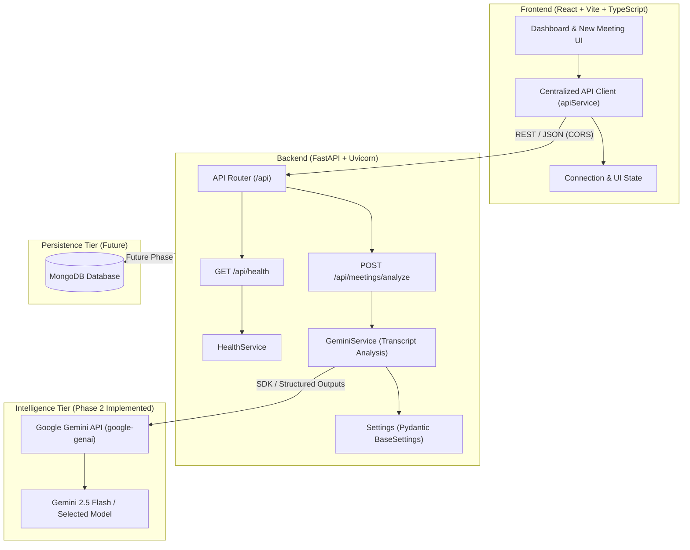

# MeetMind AI — System Architecture & Design Documentation

## 1. System Overview

**MeetMind AI** is an AI-powered meeting-to-action platform built to ingest raw, unstructured meeting transcripts and synthesize them into actionable insights, structured decisions, assigned deliverables, and clarifying questions.

The system is designed with a decoupled client-server architecture:
- **Client Tier**: React 18, Vite, TypeScript, Tailwind CSS, Lucide React icons.
- **Service Tier**: Python 3.11+, FastAPI, Uvicorn, Pydantic v2.
- **Intelligence Tier**: Google Gemini API via official SDK (`google-genai` v2.34+).
- **Data Tier (Future Phase)**: MongoDB for persistent meeting records and action items.

---

## 2. Architecture Diagram

---

## 3. Communication Protocols

| Route | Method | Purpose | Implementation Phase |
| :--- | :--- | :--- | :--- |
| `/api/health` | `GET` | System heartbeat & availability check | **Phase 1 (Implemented)** |
| `/api/meetings/analyze` | `POST` | Transcript parsing & Gemini AI pipeline | **Phase 2 (Implemented)** |
| `/api/meetings` | `GET/POST` | Meeting storage & historical retrieval | Planned (Phase 3) |
| `/api/actions` | `GET/PATCH` | Action item tracking & status updates | Planned (Phase 3) |

---

## 4. Gemini AI Integration Architecture

### 4.1 SDK & Model Selection
The backend leverages the official `google-genai` Python library. The default model is `gemini-2.5-flash`, configurable via `GEMINI_MODEL` in `backend/.env`.

### 4.2 Structured Output Schema Enforcement
The prompt pipeline utilizes `GenerateContentConfig` with:
- `response_mime_type="application/json"`
- `response_schema=MeetingAnalysisResponse` (Pydantic schema)
- `temperature=0.1` for deterministic extraction

### 4.3 Extraction Rules & Anti-Hallucination Guardrails
1. **Summary**: Concise, high-level summary of meeting discussions and outcomes.
2. **Discussion Points**: Key topics and technical debates raised.
3. **Decisions**: Explicit decisions agreed by participants (no assumed or fabricated decisions).
4. **Action Items**:
   - `task`: Concrete actionable description.
   - `owner`: Explicit participant assigned (set to `null` if unassigned).
   - `deadline`: Explicit timeframe mentioned (set to `null` if unspecified).
   - `status`: Defaults to `pending`.
5. **Clarification Detection**:
   - `clarification_required`: Evaluated as `true` if any task lacks clear ownership, actionable scope, or prerequisite details.
   - `clarification_question`: Formulates a direct, clarifying query addressing the ambiguity.

---

## 5. Security & Configuration Best Practices

1. **Environment Segregation**: Secrets and environment-specific parameters are managed via `.env` files; `.env.example` templates define required schema without exposing credentials.
2. **CORS Governance**: FastAPI `CORSMiddleware` restricts browser origins to approved client ports (`localhost:5173`, `localhost:3000`).
3. **No Frontend Secrets**: The frontend only communicates with the backend API. All Gemini API keys and database connection strings are confined strictly to the backend environment.
4. **Graceful Error Sanitization**: API keys are never included in log outputs, error messages, or exception traces. Upstream Gemini API errors map to standard HTTP status codes (`502 Bad Gateway`, `503 Service Unavailable`).
